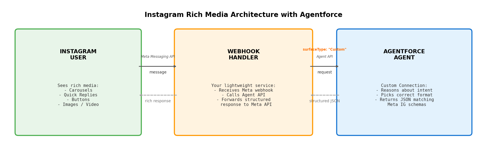

# Instagram Rich Media with Agentforce

Solution Guide — Custom Connections for Instagram

---

## Introduction

Agentforce agents can respond with rich media on Instagram — carousels, quick reply buttons, button templates with links, and media messages with images or video. This guide explains how to set it up using **Custom Connections**, a feature that lets you define structured response formats your agent can use on any channel you control.

Instead of plain text, your agent outputs structured JSON that matches Meta's Instagram Messaging API schemas. A lightweight webhook handler bridges the two APIs. The result: your customers see native Instagram rich media (scrollable cards, tappable buttons, image/video content) powered by Agentforce's reasoning engine and CRM data.

The [Custom Connections skill](https://github.com/agent-connections-tools/custom-connections-skill) automates the entire Agentforce-side setup — response formats, connection definition, and deploy script — in about 15 minutes.

---

## Getting Started (End-to-End)

Follow these steps in order. No prior Custom Connections experience required.

### What you need before you start

- A Salesforce org with an Agentforce agent already created (at least one topic configured)
- The Salesforce CLI (`sf`) installed on your machine
- A Claude Code environment with the [custom-connections-skill](https://github.com/agent-connections-tools/custom-connections-skill) repo cloned
- A Meta Business account with an Instagram Professional Account (Business or Creator) connected
- A publicly accessible server to host the webhook handler (Heroku, Railway, AWS, or similar)

### Step 1: Generate the Custom Connection metadata

1. Open Claude Code in the cloned repo
2. Run `/project:build-custom-connection`
3. When prompted for channel, pick **"Instagram rich media"**
4. Answer the remaining questions (client name, org URL, agent ID)
5. When asked about the webhook handler, say **yes** to generate it

The skill generates all response format files, the AiSurface definition, and optionally the webhook handler code in an `unpackaged/` folder.

### Step 2: Deploy metadata to your org

```bash
sf project deploy start --source-dir unpackaged/ --target-org your-org-alias
```

This deploys the 4 Instagram response formats and the AiSurface (Custom Connection definition) to your org.

### Step 3: Wire the Custom Connection to your agent

1. Go to **Setup > Agents** in your org
2. Open your agent
3. Add the Custom Connection you just deployed (it will appear by name)
4. Save

Your agent now knows it can respond with carousels, quick replies, buttons, and media on Instagram.

### Step 4: Create the External Client App (ECA)

This gives the webhook handler server-to-server access to the Agent API.

1. Go to **Setup > External Client Apps > New External Client App**
2. Name it (e.g., "Instagram Webhook Bridge"), set Distribution State to "Local"
3. Enable OAuth with scopes: `api`, `chatbot_api`, `sfap_api`
4. Check "Allow client_credentials flow"
5. Set "Run as" to a dedicated Integration User (not your personal account)
6. Generate the consumer key and secret — save both securely

Do NOT add `refresh_token` to the scopes. It breaks client_credentials.

### Step 5: Set up the webhook handler

1. Deploy the generated webhook handler code to your hosting platform
2. Set environment variables:
   ```
   SF_CONSUMER_KEY=<ECA consumer key>
   SF_CONSUMER_SECRET=<ECA consumer secret>
   SF_DOMAIN=https://yourorg.my.salesforce.com
   SF_AGENT_ID=<your agent ID>
   META_VERIFY_TOKEN=<a random string you choose>
   META_PAGE_ACCESS_TOKEN=<from Meta App Dashboard with instagram_manage_messages permission>
   META_APP_SECRET=<from Meta App Dashboard > Settings > Basic>
   META_INSTAGRAM_ID=<your Instagram Professional Account ID>
   ```
3. Note your webhook's public URL (e.g., `https://your-app.railway.app/webhook`)

### Step 6: Configure Meta's webhook

1. Go to [developers.facebook.com](https://developers.facebook.com) > your app > Instagram > Webhooks
2. Set the **Callback URL** to your webhook's public URL (e.g., `https://your-app.railway.app/webhook`)
3. Set the **Verify token** to the same value you used for `META_VERIFY_TOKEN`
4. Click "Verify and Save" — Meta will send a GET request to your webhook; it must respond correctly
5. Subscribe to the `messages` and `messaging_postbacks` webhook fields

### Step 7: Test it end-to-end

1. Open Instagram on your phone
2. Send a DM to your Professional Account — for example:
   - "Show me your products" (should return a carousel)
   - "What are my options?" (should return quick reply buttons)
   - "How do I pay my bill?" (should return a button template with a URL)
3. Verify the response renders as native Instagram rich media, not plain text
4. Tap a button or select a quick reply to confirm interactions work

If you see plain text instead of a format, check that the AiSurface is wired to the agent (Step 3) and that the webhook is passing `surfaceType: "Custom"` in the session config.

---

## Architecture



---

## Why a Webhook Handler Is Required

You cannot point Meta's Instagram webhook directly at the Agent API. Four incompatibilities require a translation layer:

| Gap | What Meta Does | What Agent API Needs |
|-----|----------------|---------------------|
| **Verification** | Sends GET challenge on registration | Has no GET handler — cannot pass verification |
| **Payload format** | `entry[].messaging[].message.text` | Flat: `{ message: { sequenceId, type, text } }` |
| **Session state** | Stateless — fires a POST per message, no session concept | Stateful — requires a pre-created session ID in the URL path |
| **Reply delivery** | Expects you to POST replies to `graph.facebook.com` | Returns response in HTTP body only — never pushes outbound |

---

## Supported Instagram Formats

| Format | Instagram Rendering | Best For | Limits |
|--------|-------------------|----------|--------|
| Quick Reply | Tappable button pills below message | Choices, confirmations, navigation | Max 13 buttons, 20 chars each |
| Generic Template (Carousel) | Horizontal scrollable cards | Product comparisons, catalogs | 1-10 cards, title 80 chars, 3 buttons each |
| Button Template | Text with structured buttons below | CTAs, links, actions | 3 buttons max, text 640 chars |
| Media Template | Image or video with optional button | Product photos, videos | 1 button max, media must be publicly accessible |

### How the Agent Picks the Right Format

| Customer Says | Agent Uses | Why |
|---------------|-----------|-----|
| "Show me your products" | Generic Template (Carousel) | Multiple products to compare visually |
| "What's my order status?" | Quick Reply | 2-3 clear next actions (Track / Cancel / Contact) |
| "How do I pay my bill?" | Button Template | URL button redirects to payment portal |
| "Show me the product details" | Media Template | Single product image with "Buy Now" button |
| "Do you have a size guide?" | Button Template | web_url button opens the size guide page |

---

## Key Differences from WhatsApp

If you're already running WhatsApp with Custom Connections, here's what changes for Instagram:

| Aspect | WhatsApp | Instagram |
|--------|----------|-----------|
| Quick reply limit | 3 buttons | 13 buttons |
| Carousel | Approximate (multi-image) | Native generic template |
| List message | Supported | Not supported — use carousel or quick replies |
| CTA URL button | Standalone format | Part of button template |
| Media caption | Inline with media | Not supported — use separate text message |
| Webhook payload | `entry[].changes[].value.messages[]` | `entry[].messaging[].message` |
| Reply API | `POST /{phone-number-id}/messages` | `POST /{instagram-id}/messages` |
| Auth | WhatsApp Cloud API token | Page Access Token with instagram_manage_messages |

---

## Authentication: Configuring an External Client App (ECA)

The webhook is server-to-server code. It needs OAuth 2.0 `client_credentials` to call the Agent API headlessly. Configuration is identical to WhatsApp — see [WHATSAPP.md](./WHATSAPP.md#authentication-configuring-an-external-client-app-eca) for the full ECA setup guide.

The only difference is the environment variables for the Meta side:

```
META_PAGE_ACCESS_TOKEN=<Page Access Token with instagram_manage_messages permission>
META_APP_SECRET=<from Meta App Dashboard > Settings > Basic>
META_INSTAGRAM_ID=<your Instagram Professional Account ID>
META_VERIFY_TOKEN=<random secret you set in Meta's webhook config>
```

---

## How It Works (Step by Step)

1. **Customer sends an Instagram DM** — Meta's platform receives it
2. **Your webhook handler receives the event** — Lightweight service you host
3. **Webhook calls Agent API with surfaceType: "Custom"** — Activates Instagram response formats
4. **Agentforce agent reasons about intent** — Picks the right format for the response
5. **Agent returns structured JSON** — Already matches Meta's template schemas
6. **Webhook forwards JSON to Meta's Send API** — Customer sees rich cards in Instagram DMs

---

## Security Checklist

| Check | Why it matters |
|-------|---------------|
| Verify `X-Hub-Signature-256` on every inbound event | Without verification, an attacker can forge Instagram events |
| Run-as is a dedicated Integration User | A real user logs out or leaves — breaking the webhook |
| Permission set grants only Agent invocation perms | Limits blast radius if credentials leak |
| `chatbot_api` and `sfap_api` scopes are present; `refresh_token` is NOT | Without these, the Agent API rejects the token |
| Consumer key + secret stored in a managed secrets store | Hardcoded secrets end up in Git history |
| Webhook caches the access token and refreshes before expiry | Re-fetching per event hits rate limits |
| One ECA per environment (dev / staging / prod) | Sharing credentials across environments means a dev leak compromises prod |

---

## Common Configuration Mistakes

| Mistake | Symptom | Fix |
|---------|---------|-----|
| Missing `instagram_manage_messages` permission on token | Send API returns `OAuthException` | Regenerate token with correct permissions in Meta App Dashboard |
| Using a personal Instagram account (not Professional) | Webhook never fires | Convert to Business or Creator account in Instagram settings |
| Not subscribing to `messaging_postbacks` | Button taps are silently dropped | Add subscription in Meta App Dashboard > Webhooks |
| `is_echo` messages not filtered | Webhook enters infinite loop | Handler must skip messages where `message.is_echo === true` |
| Instagram ID vs Page ID confusion | Send API returns "recipient not found" | Use the Instagram-Scoped ID (IGSID), not the Facebook Page ID |

---

## Frequently Asked Questions

### Does Instagram support all the same formats as WhatsApp?

No. Instagram does NOT support list messages or standalone CTA URL buttons. It does support carousels natively (which WhatsApp doesn't — WhatsApp approximates with multiple image messages). Instagram also supports up to 13 quick reply buttons vs WhatsApp's 3.

### What about Instagram Stories or Reels interactions?

Story replies arrive as regular messages with an `attachments` array containing the story media. The webhook handler treats these as text messages (the reply text). Reel interactions are not routed to the Messaging API.

### Can I run both WhatsApp and Instagram on the same agent?

Yes. Each gets its own Custom Connection (AiSurface) with channel-specific response formats. The agent uses `surfaceId` to determine which formats are available for each session. You'll need separate webhook handlers (or a unified handler that detects the source).

### Is this available today?

**Yes.** No roadmap dependency. Uses:
- Agent API (GA)
- Custom Connections / AiSurface / AiResponseFormat (GA)
- Meta Instagram Messaging API (Meta's product, available to all apps with instagram_manage_messages approval)

---

## What We Have Ready Today

| Generated | Purpose |
|-----------|---------|
| 4 Instagram response formats | Pre-built schemas matching Meta's API with character limits enforced |
| Custom Connection definition | Tells the agent "this channel supports these rich formats" |
| Surface instructions | Tells the agent WHEN to pick each format |
| Automated deploy script | One command deploys everything and wires it to the agent |
| Optional: MIAW handoff | Agent hands off to human with full context when it can't resolve |

**Time to configure:** ~15 minutes from zero to deployed.

**Try it:** [github.com/agent-connections-tools/custom-connections-skill](https://github.com/agent-connections-tools/custom-connections-skill) — clone, run `/project:build-custom-connection`, answer 5 questions, get a deploy-ready package.
