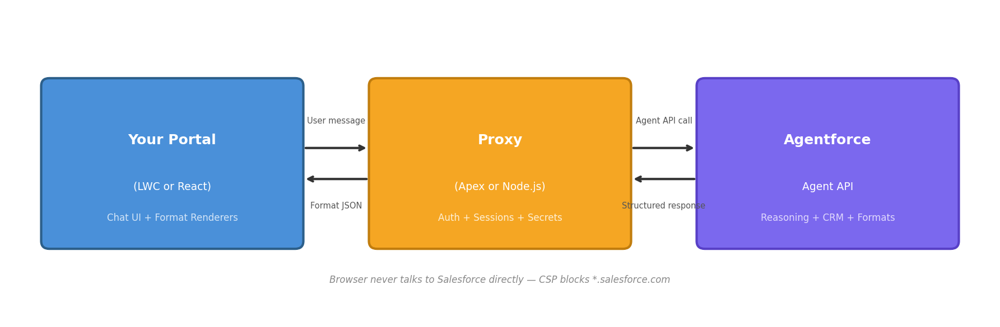

# In-App Portal Rich Media with Agentforce

Solution Guide — Custom Connections for Web Portals and Custom UIs

---

## Introduction

Agentforce agents can respond with rich interactive formats inside your own web application or Experience Cloud site — cards, lists, button groups, forms, and carousels. This guide explains how to set it up using **Custom Connections**, a feature that lets you define structured response formats your agent can use on any surface you control.

Instead of plain text, your agent outputs structured JSON that your frontend renders as native UI components. A server-side proxy holds secrets and manages sessions. The result: your users see interactive rich media (tappable buttons, scrollable carousels, input forms) inside your portal, powered by Agentforce's reasoning engine and CRM data.

This is the **only** path for embedding Agentforce in your own UI. Messaging channels (WhatsApp, Teams) have out-of-the-box options. Custom portals require Custom Connections.

The [Custom Connections skill](https://github.com/agent-connections-tools/custom-connections-skill) automates the entire Agentforce-side setup — response formats, connection definition, proxy template, and deploy script — in about 15 minutes.

---

## Architecture



The browser/app **never** talks to Salesforce directly. All authentication and session management lives in the proxy.

---

## Why a Proxy Is Required

You cannot call the Agent API directly from a browser. Four incompatibilities require a server-side proxy:

| Gap | What a Browser Does | What Agent API Needs |
|-----|---------------------|---------------------|
| **Secrets** | JavaScript is visible to the user — cannot hold client_credentials | OAuth 2.0 bearer token from Salesforce ECA (client_credentials) |
| **CORS** | Browser enforces same-origin policy — Agent API doesn't serve CORS headers | Server-to-server call with no CORS restriction |
| **Session state** | Browser has a session cookie but no Agent API session | Stateful — requires a pre-created session ID in the URL path |
| **Token security** | Tokens in localStorage/sessionStorage are vulnerable to XSS | Token lives server-side only, never exposed to browser |

The proxy solves all four: holds secrets, makes server-to-server calls, maps browser sessions to Agent API sessions, and keeps tokens off the client.

---

## Two Options

| Option | Stack | Auth Model | Best For |
|--------|-------|-----------|----------|
| **Option A: Apex + LWC** | Apex Continuation + LWC on Experience Cloud | Salesforce Identity (inherited) | Teams already on Salesforce, fastest path to production |
| **Option B: Node.js + React** | Express proxy + React/Vite frontend | OIDC (Auth0 / Okta / SF Identity) | Custom portals, non-Salesforce frontends, high-volume |

Both generate the same AiSurface metadata and response format schemas. The agent doesn't know or care which proxy is calling it.

---

## Authentication: Configuring an External Client App (ECA)

The proxy is server-to-server code. It needs OAuth 2.0 `client_credentials` to call the Agent API headlessly. That's what an External Client App (ECA) is for.

### Step 1: Create the External Client App

Setup > External Client Apps > New External Client App

| Field | Value | Notes |
|-------|-------|-------|
| Name | Portal Agent Proxy | Or your preferred name |
| Distribution State | Local | Single-org install |
| Contact email | A monitored team alias | Salesforce contacts this address about deprecations |

### Step 2: Configure the OAuth policy

| Field | Value | Why |
|-------|-------|-----|
| Enable OAuth | Yes | Required |
| Callback URL | `https://login.salesforce.com/services/oauth2/success` | Required field; not used in client_credentials |
| OAuth Scopes | `api`, `chatbot_api`, `sfap_api` | api for general access; chatbot_api for Agent API; sfap_api to invoke the agent |
| Allow client_credentials flow | Yes | Critical — without it, the proxy can't get a token without a user |
| Run as | Dedicated Integration User | Use an Integration User license, not a real person |
| Generate consumer key/secret | Yes | Store in a secrets manager — never commit to source |

**Do NOT include `refresh_token` in the scopes.** It's incompatible with client_credentials and will cause token requests to fail.

### Step 3: Configure org-level policies

| Setting | Value |
|---------|-------|
| Permitted Users | Admin approved users are pre-authorized |
| IP Relaxation | Relax IP restrictions (server-to-server) |
| Permission set assigned to integration user | Custom permset granting Agent invocation + agent metadata access only |

### Step 4: Wire the proxy

**For Option A (Apex):** Create a Named Credential pointing to your org's Agent API URL, using the ECA credentials.

**For Option B (Node):** Set environment variables:

```
SF_LOGIN_URL=https://yourorg.my.salesforce.com
SF_CLIENT_ID=<ECA consumer key>
SF_CLIENT_SECRET=<ECA consumer secret>
SF_AGENT_ID=<your Agentforce Agent ID>
```

The proxy fetches a Salesforce token via:

```
POST https://yourorg.my.salesforce.com/services/oauth2/token
Content-Type: application/x-www-form-urlencoded

grant_type=client_credentials
&client_id=<SF_CLIENT_ID>
&client_secret=<SF_CLIENT_SECRET>
```

Then starts an Agent session with `surfaceType: "Custom"` to activate portal response formats:

```json
POST /einstein/ai-agent/v1/agents/<SF_AGENT_ID>/sessions
Authorization: Bearer <access_token>

{
  "externalSessionKey": "<browser session ID or user ID>",
  "instanceConfig": { "endpoint": "https://yourorg.my.salesforce.com" },
  "streamingCapabilities": { "chunkTypes": ["Text"] },
  "surfaceConfig": { "surfaceType": "Custom" },
  "bypassUser": true
}
```

**Note:** `bypassUser: true` means the agent runs without a linked Salesforce Contact. This is fine for anonymous interactions. If you need personalized responses (order history, account details), set `bypassUser: false` and map the portal user's identity to a Contact record.

---

## End-User Authentication

The proxy authenticates to Salesforce. But who authenticates the portal user to the proxy?

### Option A (Apex + LWC): Already solved

Experience Cloud users are authenticated via Salesforce Identity. The LWC component inherits the user's session — no additional auth layer needed.

**Guest users:** For unauthenticated Experience Cloud sites, the LWC runs under a guest-user license. The component must be configured to support this (appropriate object permissions on the guest profile).

### Option B (Node + React): OIDC required

The proxy validates end-user JWTs against your IdP's JWKS endpoint on every request.

| IdP | Configuration |
|-----|---------------|
| Auth0 | `AUTH_JWKS_URI=https://YOUR_DOMAIN.auth0.com/.well-known/jwks.json` |
| Okta | `AUTH_JWKS_URI=https://YOUR_DOMAIN.okta.com/oauth2/default/v1/keys` |
| Salesforce Identity | `AUTH_JWKS_URI=https://YOUR_ORG.my.salesforce.com/id/keys` |

The flow:
1. Portal user authenticates with your IdP (standard OIDC redirect or embedded login)
2. Portal sends the JWT with every proxy request (`Authorization: Bearer <token>`)
3. Proxy validates the token (signature, issuer, audience, expiry)
4. On success, maps the authenticated user to an Agent API session

**`ALLOW_ANONYMOUS=true`** exists for local development only. In production, auth is always required. The proxy defaults to auth-required — no flag means no anonymous access.

---

## How It Works (Step by Step)

### Option A: Apex + LWC

1. **User opens the Experience Cloud page** — LWC calls `startCreateSession` (Continuation)
2. **Apex creates Agent API session** — stores session ID in Platform Cache (30 min TTL)
3. **User types a message** — LWC calls `startSendMessage` (Continuation, 120s timeout)
4. **Apex sends message to Agent API** — agent reasons, selects format, returns structured JSON
5. **Apex parses response** — returns structured data to LWC
6. **LWC renders the format** — Card, List, ButtonGroup, Form, or Carousel
7. **User interacts** — button clicks / form submissions become new messages

### Option B: Node.js + React

1. **User opens the portal** — React app loads, user is authenticated via IdP
2. **User sends a message** — React POSTs to `/api/agent/message` with JWT
3. **Proxy validates JWT** — checks signature against JWKS
4. **Proxy gets/creates Agent API session** — maps user ID → session (30 min TTL)
5. **Proxy calls Agent API** — agent reasons, selects format, returns structured JSON
6. **Proxy returns response** — structured format objects sent back to React
7. **React renders the format** — FormatRenderer routes to the correct component
8. **User interacts** — button clicks / form submissions become new messages

---

## Responsibilities

| Layer | Owner | What It Does |
|-------|-------|-------------|
| AI Reasoning Engine | Salesforce (Agentforce) | Decides WHEN to use each format based on conversation context |
| CRM Data Access | Salesforce (Agentforce) | Customer history, lead info, preferences, service records |
| Trust Layer | Salesforce (Agentforce) | PII masking, hallucination detection, audit trail |
| Business Logic | Salesforce (Agentforce) | Lead assignment, case routing, approval processes |
| Portal Response Formats | Pre-built (our tooling) | 5 schemas with field limits enforced |
| Proxy | Customer (Apex or ~200 lines Node) | Routes requests, holds secrets, manages sessions |
| Frontend | Customer (LWC or React) | Renders formats, handles user input |
| End-User Auth | Customer (IdP) | Authenticates portal users (OIDC for Node; SF Identity for Apex) |

---

## Supported Formats

| Format | Portal Rendering | Best For | Limits |
|--------|-----------------|----------|--------|
| InAppCard | Bordered card with title, body, image, buttons | Single-item display (order, article, product) | Max 4 buttons |
| InAppList | Vertical list with icon, title, subtitle | Search results, recent items, recommendations | 2-10 items |
| InAppButtonGroup | 1-6 labeled action buttons | Confirm/cancel, navigation, quick choices | Max 6 buttons |
| InAppForm | Input fields + submit | Data collection (lead capture, feedback, preferences) | 1-10 fields; text/email/number/select/checkbox only |
| InAppCarousel | Horizontal scrollable cards with images | Product comparisons, catalog browse | 2-8 cards, max 2 buttons each |

### How the Agent Picks the Right Format

| User Says | Agent Uses | Why |
|-----------|-----------|-----|
| "Show me my open cases" | InAppList | Multiple items to scan |
| "What's the status of order #4521?" | InAppCard | Single item with details + next actions |
| "I'd like to schedule a callback" | InAppForm | Collecting structured data (date, time, reason) |
| "Compare your pricing plans" | InAppCarousel | Visual side-by-side comparison |
| "Should I escalate or close this?" | InAppButtonGroup | 2-3 clear action choices |

---

## Frequently Asked Questions

### Why Custom Connections and not just a REST API call?

Custom Connections tell the agent WHICH formats exist and WHEN to use them. Without it, the agent would only respond with plain text. The AiSurface metadata + response format schemas are what make the agent format-aware — they're the instruction set that says "you can respond with a card, a list, a form, etc."

### Can I use this with an existing React/Angular/Vue app?

**Yes.** The proxy is frontend-agnostic — it returns JSON. The React starter is one reference implementation. For Angular or Vue, use the same proxy and render the JSON contracts with your own components. The format contracts (what fields exist, what types they are) are documented in the response format schemas.

### What about mobile apps (iOS/Android)?

Same pattern. The proxy returns JSON — your native app renders it with SwiftUI/Compose components instead of React. The proxy doesn't care what's calling it as long as it gets a valid JWT.

### Can I use the same agent for both a portal AND a messaging channel?

**Yes — starting in Summer '26.** Multiple Custom Connections on a single agent ships in the Summer '26 release. Until then, use one agent per channel/surface.

### What happens when the agent doesn't use a format?

The agent returns plain text. Your frontend renders it as a normal chat message. Formats are optional — the agent uses them when the response benefits from structure, and uses plain text when it doesn't.

### How do I add more formats later?

Use the `update-connection` skill to add response formats to an existing connection without rebuilding from scratch.

---

## What We Have Ready Today

The **Custom Connections skill** generates the entire Agentforce-side configuration:

| Generated | Purpose |
|-----------|---------|
| 5 portal response formats | Pre-built schemas for Card, List, ButtonGroup, Form, Carousel |
| Custom Connection definition | AiSurface telling the agent "this portal supports these rich formats" |
| Surface instructions | Tells the agent WHEN to pick each format |
| Apex proxy + LWC component | Drop into Experience Cloud with auth already solved |
| Node proxy + React starter | For custom portals with Auth0/Okta/SF Identity |
| Automated deploy script | One command deploys everything and wires it to the agent |

**Time to configure:** ~15 minutes from zero to deployed metadata. Add 1-2 hours for proxy setup (Named Credential or IdP configuration).

---

## Sample: What the Agent Returns

When a user asks *"Show me my open cases"*, the agent returns an InAppList:

```json
{
  "responseFormatType": "InAppList",
  "title": "Your Open Cases",
  "items": [
    {
      "id": "case-001",
      "title": "Login issue on mobile app",
      "subtitle": "High priority · In Progress",
      "iconUrl": "https://yourorg.my.salesforce.com/img/cases/high.svg",
      "action": { "type": "reply", "value": "Tell me more about case 00041523" }
    },
    {
      "id": "case-002",
      "title": "Billing discrepancy Q4",
      "subtitle": "Medium priority · New",
      "iconUrl": "https://yourorg.my.salesforce.com/img/cases/medium.svg",
      "action": { "type": "reply", "value": "Tell me more about case 00041587" }
    },
    {
      "id": "case-003",
      "title": "Feature request: dark mode",
      "subtitle": "Low priority · Waiting on Customer",
      "iconUrl": "https://yourorg.my.salesforce.com/img/cases/low.svg",
      "action": { "type": "reply", "value": "Tell me more about case 00041602" }
    }
  ]
}
```

The proxy passes this JSON to the frontend. The React app renders it as a clickable list. The LWC renders it with SLDS styling.

---

## Security Checklist

| Check | Why It Matters |
|-------|---------------|
| ECA consumer key/secret in a managed secrets store (not env files in Git) | Hardcoded secrets in Git history = leaked credentials |
| Run-as is a dedicated Integration User, not a real person | A real user logs out or changes role — breaks the proxy |
| Permission set grants only Agent invocation (no Modify All Data) | Limits blast radius if credentials are leaked |
| `chatbot_api` and `sfap_api` scopes present; `refresh_token` NOT in scope list | Without these, Agent API rejects the token; refresh_token breaks client_credentials |
| Proxy caches access token, refreshes ~5 min before expiry | Re-fetching per request hits Salesforce rate limits |
| Proxy never logs access tokens or consumer secrets | Tokens in logs = tokens leaked to anyone with log access |
| CSP blocks `*.salesforce.com` from browser origins (Node path) | Enforces "browser never talks to Salesforce" at infrastructure level |
| End-user JWT validated on every request (Node path) | Without it, anyone can talk to your agent |
| `ALLOW_ANONYMOUS` is NOT set in production | Defaults to auth-required; flag is for local dev only |
| One ECA per environment (dev / staging / prod) | Sharing credentials across environments means a dev leak compromises prod |
| Platform Cache allocated (Apex path) | Without it, sessions can't persist and every message creates a new session |
| Named Credential configured (Apex path) | Hardcoding credentials in Apex is a security violation |

---

## Common Configuration Mistakes

| Mistake | Symptom | Fix |
|---------|---------|-----|
| Browser calls Agent API directly | CORS error in console | All calls must go through the proxy — never expose the Agent API URL to the browser |
| `refresh_token` scope on the ECA | Token request fails with `invalid_grant` | Remove `refresh_token` from scope list |
| Forgot to enable client_credentials flow | Token request returns `unsupported_grant_type` | Edit ECA > OAuth Settings > check "Allow client_credentials flow" |
| `ALLOW_ANONYMOUS=true` left in production | Anyone can use the agent without auth | Remove the env var — proxy defaults to auth-required |
| Named Credential not configured (Apex) | Callout fails with "Unauthorized endpoint" | Setup > Named Credentials > create `AgentAPI_{ClientName}` with OAuth 2.0 |
| Platform Cache not allocated (Apex) | "Cache not available" error, session lost every request | Setup > Platform Cache > allocate at least 1MB to org partition |
| Synchronous Apex callout instead of Continuation | Transaction CPU time limit exceeded | Use `startSendMessage` (Continuation) not a synchronous `@AuraEnabled` call |
| LWC component uses `cacheable=true` | Continuation fails silently | Continuation methods must NOT be `cacheable=true` |
| JWKS URI wrong (Node) | All requests return 401 | Verify `AUTH_JWKS_URI` matches your IdP's published JWKS endpoint |
| Auth audience mismatch (Node) | Valid tokens rejected with "invalid audience" | `AUTH_AUDIENCE` must match the audience claim in your IdP-issued tokens |

---

## Recommended Next Steps

**POC Scope:** Pick one internal workflow (e.g., "case status lookup" or "schedule a callback"). Configure agent topic + portal Custom Connection + one of the two proxy options.

**Timeline:**
- Metadata + deploy: 15 minutes (skill-generated)
- Option A (Apex + LWC): 1-2 hours (Named Credential + Platform Cache + add component to page)
- Option B (Node + React): 2-4 hours (IdP configuration + deploy proxy + wire frontend)
- End-to-end demo: same day

**Try it:** Clone [the repo](https://github.com/agent-connections-tools/custom-connections-skill), run `/project:build-custom-connection`, pick "In-app portal / custom UI," and get a deploy-ready package.

**What we provide:**
- Custom Connections skill — generates all Agentforce-side metadata
- Two proxy templates (Apex + LWC for Experience Cloud, Node + React for custom portals)
- Five response format schemas with field limits enforced
- Reference auth middleware for Auth0, Okta, and Salesforce Identity
- This solution guide
