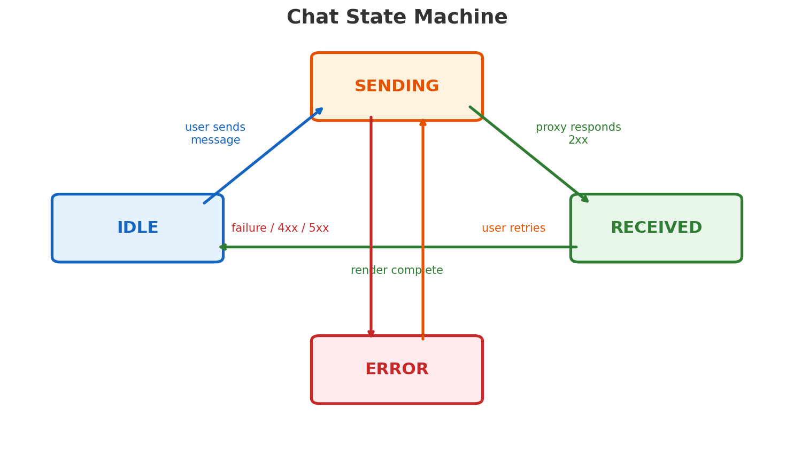

# Porting Guide: Portal Proxy to Other Frameworks

The portal proxy is a thin HTTP layer between your frontend and the Agentforce agent. It is completely frontend-agnostic: you send a message, you get back JSON, you render it however your framework handles UI. The two reference implementations (LWC and React) are just examples. This guide shows how to port to anything else.

---

## JSON Contracts

The proxy returns an array of response objects. Each object has a `type` field that tells you what to render. Here are the TypeScript interfaces for all five format types:

```typescript
// Shared types
interface Button {
  id: string;
  label: string;
  action: "link" | "reply" | "submit";
  value: string;
}

// 1. Card with optional image and buttons
interface InAppCard {
  type: "InAppCard";
  title: string;
  body: string;
  imageUrl?: string;
  buttons?: Button[];
}

// 2. Scrollable list of items
interface InAppList {
  type: "InAppList";
  title: string;
  items: {
    id: string;
    title: string;
    subtitle?: string;
    iconUrl?: string;
    action?: {
      type: "link" | "reply";
      value: string;
    };
  }[];
}

// 3. Standalone button group
interface InAppButtonGroup {
  type: "InAppButtonGroup";
  body: string;
  buttons: {
    id: string;
    label: string;
    style?: "primary" | "secondary" | "danger";
    action: "reply" | "link" | "submit";
    value: string;
  }[];
}

// 4. User-fillable form
interface InAppForm {
  type: "InAppForm";
  title: string;
  description?: string;
  fields: {
    id: string;
    label: string;
    type: "text" | "email" | "number" | "select" | "checkbox";
    placeholder?: string;
    required?: boolean;
    pattern?: string;
    options?: { label: string; value: string }[];
  }[];
  submitLabel?: string;
  cancelLabel?: string;
}

// 5. Horizontal card carousel
interface InAppCarousel {
  type: "InAppCarousel";
  title: string;
  cards: {
    id: string;
    title: string;
    description?: string;
    imageUrl: string;
    badge?: string;
    buttons: Button[];
  }[];
}

// Union type for switch/match logic
type AgentResponse =
  | InAppCard
  | InAppList
  | InAppButtonGroup
  | InAppForm
  | InAppCarousel;
```

---

## Calling the Proxy

Three endpoints. All expect JSON bodies where applicable.

### Send a message

```typescript
const res = await fetch("/api/agent/message", {
  method: "POST",
  headers: {
    "Content-Type": "application/json",
    Authorization: `Bearer ${jwt}`,
  },
  body: JSON.stringify({ message: "What cases are open?" }),
});

const data = await res.json();
// data.responses is AgentResponse[]
```

### Reset the conversation

```typescript
await fetch("/api/agent/session/reset", {
  method: "POST",
  headers: { Authorization: `Bearer ${jwt}` },
});
```

### Health check

```typescript
const health = await fetch("/api/health");
// 200 = healthy
```

---

## Chat State Machine

Every implementation should track conversation state. This prevents double-sends and gives users feedback.



Minimal implementation:

```typescript
type ChatState = "idle" | "sending" | "received" | "error";

// Transition rules
// idle     → sending   (user submits message)
// sending  → received  (proxy responds 2xx)
// sending  → error     (network failure or 4xx/5xx)
// received → idle      (after rendering responses)
// error    → sending   (user clicks retry)
```

Disable the send button during `sending`. Show a spinner or typing indicator. On `error`, surface the failure and offer retry.

---

## Framework Porting Examples

### Angular (Service + Component)

**Service** (`agent.service.ts`):

```typescript
@Injectable({ providedIn: "root" })
export class AgentService {
  private http = inject(HttpClient);
  private baseUrl = environment.proxyUrl;

  sendMessage(message: string, jwt: string): Observable<{ responses: AgentResponse[] }> {
    return this.http.post<{ responses: AgentResponse[] }>(
      `${this.baseUrl}/api/agent/message`,
      { message },
      { headers: { Authorization: `Bearer ${jwt}` } }
    );
  }

  resetSession(jwt: string): Observable<void> {
    return this.http.post<void>(
      `${this.baseUrl}/api/agent/session/reset`,
      null,
      { headers: { Authorization: `Bearer ${jwt}` } }
    );
  }
}
```

**Component** (`chat.component.ts`):

```typescript
@Component({ selector: "app-chat", templateUrl: "./chat.component.html" })
export class ChatComponent {
  private agent = inject(AgentService);
  state: ChatState = "idle";
  responses: AgentResponse[] = [];

  send(message: string) {
    this.state = "sending";
    this.agent.sendMessage(message, this.jwt).subscribe({
      next: (data) => {
        this.responses = [...this.responses, ...data.responses];
        this.state = "received";
      },
      error: () => { this.state = "error"; },
    });
  }
}
```

In the template, use `ngSwitch` on `response.type` to pick the correct component for each format.

---

### React Native

The JSON contracts are identical. The difference is rendering: use `<View>`, `<Text>`, `<Image>`, `<FlatList>` instead of DOM elements.

```tsx
function AgentMessage({ response }: { response: AgentResponse }) {
  switch (response.type) {
    case "InAppCard":
      return (
        <View style={styles.card}>
          <Text style={styles.title}>{response.title}</Text>
          <Text style={styles.body}>{response.body}</Text>
          {response.imageUrl && <Image source={{ uri: response.imageUrl }} style={styles.image} />}
          {response.buttons?.map((btn) => (
            <Pressable key={btn.id} onPress={() => handleAction(btn)} accessibilityRole="button">
              <Text>{btn.label}</Text>
            </Pressable>
          ))}
        </View>
      );
    case "InAppCarousel":
      return (
        <FlatList
          horizontal
          data={response.cards}
          keyExtractor={(c) => c.id}
          renderItem={({ item }) => <CarouselCard card={item} />}
          accessibilityRole="list"
        />
      );
    // ... other cases
  }
}
```

Use the same `fetch`-based service code from the contracts section. React Native supports the Fetch API natively.

---

### iOS (SwiftUI)

**Models** (Codable structs):

```swift
enum AgentResponseType: String, Codable {
    case InAppCard, InAppList, InAppButtonGroup, InAppForm, InAppCarousel
}

struct ButtonModel: Codable, Identifiable {
    let id: String
    let label: String
    let action: String
    let value: String
}

struct InAppCardModel: Codable {
    let type: AgentResponseType
    let title: String
    let body: String
    let imageUrl: String?
    let buttons: [ButtonModel]?
}

struct AgentMessageResponse: Codable {
    let responses: [AgentResponseWrapper]
}
```

**View**:

```swift
struct CardView: View {
    let card: InAppCardModel

    var body: some View {
        VStack(alignment: .leading, spacing: 8) {
            Text(card.title).font(.headline)
            Text(card.body).font(.body)
            if let url = card.imageUrl {
                AsyncImage(url: URL(string: url)) { image in
                    image.resizable().aspectRatio(contentMode: .fit)
                } placeholder: { ProgressView() }
            }
            ForEach(card.buttons ?? [], id: \.id) { btn in
                Button(btn.label) { handleAction(btn) }
                    .accessibilityLabel(btn.label)
            }
        }
        .accessibilityElement(children: .contain)
    }
}
```

Use `URLSession` for network calls. Decode using `JSONDecoder`. Manage state with `@Published` properties in an `ObservableObject`.

---

### Android (Jetpack Compose)

**Data classes**:

```kotlin
@Serializable
data class AgentButton(
    val id: String,
    val label: String,
    val action: String,
    val value: String
)

@Serializable
data class InAppCard(
    val type: String,
    val title: String,
    val body: String,
    val imageUrl: String? = null,
    val buttons: List<AgentButton>? = null
)

@Serializable
data class AgentMessageResponse(
    val responses: List<JsonObject>
)
```

**Composable**:

```kotlin
@Composable
fun CardMessage(card: InAppCard) {
    Card(modifier = Modifier.fillMaxWidth().padding(8.dp)) {
        Column(modifier = Modifier.padding(16.dp)) {
            Text(card.title, style = MaterialTheme.typography.titleMedium)
            Text(card.body, style = MaterialTheme.typography.bodyMedium)
            card.imageUrl?.let { url ->
                AsyncImage(model = url, contentDescription = card.title)
            }
            card.buttons?.forEach { btn ->
                Button(
                    onClick = { handleAction(btn) },
                    modifier = Modifier.semantics { contentDescription = btn.label }
                ) {
                    Text(btn.label)
                }
            }
        }
    }
}
```

Use Ktor or Retrofit for HTTP. Parse the `type` field from each JSON object to decide which data class to deserialize into. Use a `ViewModel` with `StateFlow` for chat state.

---

## Accessibility Requirements

Every porting implementation must satisfy these baseline requirements:

### Keyboard Navigation

- All interactive elements (buttons, links, form fields) must be focusable via Tab.
- Enter or Space activates buttons. Escape closes modals or cancels forms.
- Carousel cards should support left/right arrow keys to move focus between cards.

### ARIA Roles and Attributes

| Format | Container Role | Notes |
|--------|---------------|-------|
| InAppCard | `article` or `region` | Use `aria-label` with the card title |
| InAppList | `list` with `listitem` children | Each item gets `role="listitem"` |
| InAppButtonGroup | `group` with `aria-label` | Describe the group purpose |
| InAppForm | `form` with `aria-labelledby` | Point to the title element |
| InAppCarousel | `region` with `aria-roledescription="carousel"` | Cards are `role="group"` with `aria-label` |

### Focus Management

- After the agent responds, move focus to the first new response element. This ensures screen reader users are not left stranded at the input field.
- When a form submits, return focus to the message input.
- When an error occurs, focus the error message or retry button.

### Screen Reader Announcements

- Use a live region (`aria-live="polite"`) to announce when the agent is typing and when a response arrives.
- Button actions that navigate away should announce the destination.
- Form validation errors should be announced immediately via `aria-describedby` linked to error text.

### Native Platform Equivalents

- **iOS**: Use `.accessibilityLabel()`, `.accessibilityHint()`, and `AccessibilityFocusState` for focus routing.
- **Android**: Use `contentDescription`, `semantics { }` modifiers, and `LiveData` announcements via `AccessibilityEvent`.
- **React Native**: Use `accessibilityRole`, `accessibilityLabel`, and `AccessibilityInfo.announceForAccessibility()`.

---

## Checklist for a Complete Port

1. Parse all 5 response types from `data.responses`
2. Render each type with appropriate native components
3. Implement the state machine (idle, sending, received, error)
4. Handle button actions: `link` opens URL, `reply` sends value as next message, `submit` posts form data
5. Validate forms client-side using `required`, `pattern`, and `type` constraints
6. Meet all accessibility requirements above
7. Support session reset (clear local state + call the reset endpoint)
8. Handle token expiry gracefully (refresh or re-authenticate before retry)
