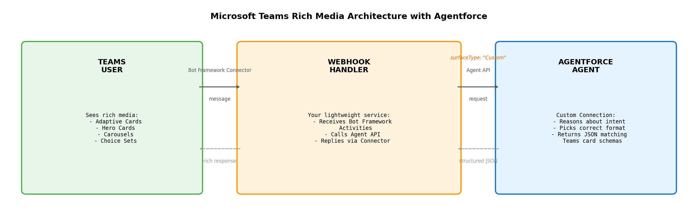

# Microsoft Teams Rich Media with Agentforce

Solution Guide — Custom Connections for Microsoft Teams

---

## Introduction

Agentforce agents can respond with rich media in Microsoft Teams — Adaptive Cards, Hero Cards, carousels, and choice sets. This guide explains how to set it up using **Custom Connections**, a feature that lets you define structured response formats your agent can use on any channel you control.

Instead of plain text, your agent outputs structured JSON that matches Microsoft's Teams card schemas. A lightweight webhook handler bridges the two APIs. The result: your users see native Teams rich media (tappable buttons, scrollable carousels, dropdown pickers, image cards) powered by Agentforce's reasoning engine and CRM data.

The [Custom Connections skill](https://github.com/agent-connections-tools/custom-connections-skill) automates the entire Agentforce-side setup — response formats, connection definition, and deploy script — in about 15 minutes.

---

## Architecture



---

## Why a Webhook Handler Is Required

You cannot point Microsoft's Bot Framework directly at the Agent API. Four incompatibilities require a translation layer:

| Gap | What Bot Framework Does | What Agent API Needs |
|-----|------------------------|---------------------|
| **Authentication** | Sends JWT token per request (Azure AD-issued) that your bot must validate | OAuth 2.0 bearer token from Salesforce ECA (client_credentials) |
| **Payload format** | Activity object: `{ type: "message", text: "...", from: {...}, channelId: "msteams" }` | Flat: `{ message: { sequenceId, type, text } }` |
| **Session state** | Conversational but stateless from your bot's perspective — each Activity arrives independently | Stateful — requires a pre-created session ID in the URL path |
| **Reply delivery** | You must POST back to `serviceUrl` provided in the Activity | Returns response in HTTP body only — never pushes outbound |

The ECA (External Client App) is only an OAuth credential — it authenticates your service to the Agent API. It does not receive Bot Framework Activities or transform payloads.

---

## Authentication: Configuring an External Client App (ECA)

The webhook is server-to-server code. It needs OAuth 2.0 `client_credentials` to call the Agent API headlessly. That's what an External Client App (ECA) is for — it replaces the older Connected App pattern with a cleaner separation of policies and consumer identity.

Configure one ECA in the org that hosts the agent before deploying the webhook.

### Step 1: Create the External Client App

Setup > External Client Apps > New External Client App

| Field | Value | Notes |
|-------|-------|-------|
| Name | Teams Webhook Bridge | Or your preferred name |
| Distribution State | Local | Single-org install |
| API name | Teams_Webhook_Bridge | Auto-derived from name |
| Contact email | A monitored team alias | Salesforce contacts this address about deprecations |

### Step 2: Configure the OAuth policy

| Field | Value | Why |
|-------|-------|-----|
| Enable OAuth | Yes | Required |
| Callback URL | `https://login.salesforce.com/services/oauth2/success` | Required field; not used in client_credentials but must be present |
| OAuth Scopes | `api`, `chatbot_api`, `sfap_api` | api for general access; chatbot_api for Agent API; sfap_api to invoke the agent |
| Allow client_credentials flow | Yes | Critical. Without it, the webhook can't get a token without a user. |
| Run as | Dedicated Integration User (e.g., `teams_bridge_int@yourorg.com`) | Don't use a real user. Use an Integration User license. |
| Generate consumer key/secret | Yes | Store in a secrets manager — never commit to source. |

**Do NOT include `refresh_token` in the scopes.** It's incompatible with the client_credentials flow and will cause token requests to fail with `invalid_grant`.

### Step 3: Configure org-level policies

| Setting | Value |
|---------|-------|
| Permitted Users | Admin approved users are pre-authorized |
| IP Relaxation | Relax IP restrictions (server-to-server, no user session) |
| Refresh Token Policy | Refresh tokens valid until revoked (won't matter — client_credentials doesn't issue refresh tokens) |
| Permission set assigned to integration user | Custom permset granting only Agent invocation perms + agent metadata access. No Modify All Data. |

### Step 4: Wire the webhook

In the webhook handler's environment (env vars or secrets manager):

```
SF_CONSUMER_KEY=<from ECA>
SF_CONSUMER_SECRET=<from ECA>
SF_DOMAIN=https://yourorg.my.salesforce.com
SF_AGENT_ID=<your Agentforce Agent ID, the 0Xx... ID>
MICROSOFT_APP_ID=<from Azure Bot registration>
MICROSOFT_APP_PASSWORD=<from Azure Bot registration>
```

The webhook fetches a Salesforce token via:

```
POST https://yourorg.my.salesforce.com/services/oauth2/token
Content-Type: application/x-www-form-urlencoded

grant_type=client_credentials
&client_id=<SF_CONSUMER_KEY>
&client_secret=<SF_CONSUMER_SECRET>
```

The response includes an `access_token` with ~2 hour lifetime. The webhook should:
- Cache the token in memory until ~5 minutes before expiry
- On any 401 from the Agent API, re-fetch and retry once
- Never write the token to disk or logs

Then start an Agent session with `surfaceType: "Custom"` to activate Teams response formats:

```json
POST /einstein/ai-agent/v1/agents/<SF_AGENT_ID>/sessions
Authorization: Bearer <access_token>

{
  "externalSessionKey": "<Teams conversation ID or user AAD ID>",
  "instanceConfig": { "endpoint": "https://yourorg.my.salesforce.com" },
  "tz": "America/Los_Angeles",
  "variables": [],
  "surfaceConfig": { "surfaceType": "Custom" },
  "streamingCapabilities": { "chunkTypes": ["Text"] },
  "bypassUser": true
}
```

The `surfaceType: "Custom"` is what activates the Teams response formats from the Custom Connection.

**Note:** `bypassUser: true` means the agent runs without a linked Salesforce Contact. This is fine for anonymous interactions. If you need personalized responses (order history, account details), set `bypassUser: false` and map the Teams user's AAD Object ID to a Contact record in your org.

---

## Azure Bot Registration

Your webhook handler needs to be registered as a Microsoft Bot so Teams can route messages to it.

### Step 1: Create an Azure Bot resource

1. Go to [portal.azure.com](https://portal.azure.com)
2. Search for "Azure Bot" > Create
3. Fill in:
   - **Bot handle**: Your bot's display name (e.g., "Agentforce Assistant")
   - **Subscription**: Your Azure subscription
   - **Resource group**: Create new or use existing
   - **Pricing tier**: F0 (free) for dev, S1 for production
   - **Type of app**: Single Tenant or Multi Tenant (Multi Tenant is simplest for most orgs)

### Step 2: Get Microsoft App ID and App Password

1. After creation, go to the Bot resource > Configuration
2. Copy the **Microsoft App ID** (a GUID)
3. Click "Manage Password" > New client secret
4. Copy the secret value immediately (it won't be shown again)
5. Store both in your secrets manager

### Step 3: Configure the messaging endpoint

1. In the Bot resource > Configuration > Messaging endpoint
2. Set to: `https://your-webhook-domain.com/api/messages`
3. This is the URL where Bot Framework sends Activity objects when users message your bot

### Step 4: Enable the Teams channel

1. In the Bot resource > Channels > Microsoft Teams
2. Click "Apply" to enable
3. Accept the Terms of Service

### Step 5: Install the bot in Teams

**Option A: Teams Admin Center (org-wide)**
1. Go to [admin.teams.microsoft.com](https://admin.teams.microsoft.com)
2. Teams apps > Manage apps > Upload new app
3. Upload your app manifest (ZIP containing `manifest.json`, icons)

**Option B: Developer Portal (for testing)**
1. Go to [dev.teams.microsoft.com](https://dev.teams.microsoft.com)
2. Apps > New app > Configure bot
3. Add your Microsoft App ID
4. Install for yourself or your team

---

## How It Works (Step by Step)

1. **User sends a message in Teams** — Bot Framework Connector receives it as an Activity
2. **Your webhook handler receives the Activity** — Lightweight service you host, validates JWT signature
3. **Webhook calls Agent API with surfaceType: "Custom"** — Activates Teams response formats
4. **Agentforce agent reasons about intent** — Picks the right format for the response
5. **Agent returns structured JSON** — Already matches Teams Adaptive Card / Hero Card schema
6. **Webhook POSTs the response back to serviceUrl** — User sees rich cards in Teams

---

## Responsibilities

| Layer | Owner | What It Does |
|-------|-------|-------------|
| AI Reasoning Engine | Salesforce (Agentforce) | Decides WHEN to use each format based on conversation context |
| CRM Data Access | Salesforce (Agentforce) | Customer history, lead info, preferences, service records |
| Trust Layer | Salesforce (Agentforce) | PII masking, hallucination detection, audit trail |
| Business Logic | Salesforce (Agentforce) | Lead assignment, case routing, approval processes |
| Teams Response Formats | Pre-built (our tooling) | Schemas matching Bot Framework card types with field limits enforced |
| Webhook Handler | Customer (~250 lines) | Routes Activities between Bot Framework and Agent API |

---

## Supported Teams Formats

| Format | Teams Rendering | Best For | Limits |
|--------|----------------|----------|--------|
| Adaptive Card Buttons | 1-6 tappable buttons below message | Confirm/Cancel, navigation, simple choices | Max 6 buttons per card |
| Choice Set | Dropdown or radio button list | Selection from a defined set of options | 2-20 options |
| Hero Card | Large image + title + text + buttons | Product highlights, announcements, feature cards | 1 image, 6 buttons max |
| Carousel | Horizontal scrollable cards | Product comparisons, catalogs, search results | 2-10 cards, each with image + buttons |

### How the Agent Picks the Right Format

The agent automatically selects the format based on context:

| User Says | Agent Uses | Why |
|-----------|-----------|-----|
| "Show me your product options" | Carousel | Multiple products to compare visually |
| "What's my case status?" | Adaptive Card Buttons | 2-3 clear next actions (Escalate / Close / Add Comment) |
| "Which region should I assign this to?" | Choice Set | Multiple options from a defined list |
| "Show me the latest announcement" | Hero Card | Single image with title and descriptive text |

---

## Frequently Asked Questions

### Does Agentforce support rich media in Teams?

**Yes**, via Custom Connections. The agent outputs structured JSON matching Microsoft's Adaptive Card and Hero Card schemas. All four rich format types (Adaptive Card buttons, choice set, hero card, carousel) are supported today on GA Agentforce.

### Can the same agent serve both WhatsApp AND Teams?

**Yes — starting in Summer '26.** Multiple Custom Connections on a single agent ships in the Summer '26 release. Once available, you configure different Custom Connections for each channel (one with Meta's WhatsApp schemas, one with Teams card schemas) attached to the same agent. The webhook handler for each channel calls the Agent API with the appropriate `surfaceType: "Custom"` configuration. The agent's reasoning, CRM access, and business logic stay identical.

Until Summer '26, use one agent per channel, each with its own Custom Connection.

### What about Teams proactive messages?

Proactive messages (bot-initiated, not in response to a user message) and agent conversations (reactive, user asks something) are separate flows:

| Direction | Mechanism | Example |
|-----------|-----------|---------|
| Proactive (you > user) | Bot Framework proactive messaging API using stored conversation references | "Your case was resolved" with View Details button |
| Reactive (user > you) | Agent responds via Custom Connection with rich formats | User asks about products > agent shows carousel |

Proactive messaging requires storing the `conversationReference` from a previous interaction and using the Bot Framework SDK's `continueConversation` method.

### Is this on the roadmap or available today?

**Available today.** No roadmap dependency. Uses:
- Agent API (GA)
- Custom Connections / AiSurface / AiResponseFormat (GA)
- Microsoft Bot Framework (Microsoft's product, fully available)
- Azure Bot Service (Microsoft's product, fully available)

---

## What We Have Ready Today

We have a **Custom Connections skill** that generates the entire Agentforce-side configuration:

| Generated | Purpose |
|-----------|---------|
| 4 Teams response formats | Pre-built schemas matching Bot Framework card types with field limits enforced |
| Custom Connection definition | Tells the agent "this channel supports these rich formats" |
| Surface instructions | Tells the agent WHEN to pick each format (buttons vs choice set vs carousel) |
| Automated deploy script | One command deploys everything and wires it to the agent |
| Optional: MIAW handoff | Agent hands off to human with full context when it can't resolve |

**Time to configure:** ~15 minutes from zero to deployed.

**Try it:** [github.com/agent-connections-tools/custom-connections-skill](https://github.com/agent-connections-tools/custom-connections-skill) — clone, run `/project:build-custom-connection`, answer 5 questions, get a deploy-ready package.

---

## Sample: What the Agent Returns

When a user asks *"What are my open cases?"*, the agent returns an Adaptive Card:

```json
{
  "type": "AdaptiveCard",
  "$schema": "http://adaptivecards.io/schemas/adaptive-card.json",
  "version": "1.5",
  "body": [
    {
      "type": "TextBlock",
      "text": "Your Open Cases",
      "weight": "Bolder",
      "size": "Medium"
    },
    {
      "type": "FactSet",
      "facts": [
        { "title": "Case #", "value": "00041523" },
        { "title": "Subject", "value": "Login issue on mobile app" },
        { "title": "Status", "value": "In Progress" },
        { "title": "Priority", "value": "High" }
      ]
    }
  ],
  "actions": [
    {
      "type": "Action.Submit",
      "title": "Escalate",
      "data": { "action": "escalate", "caseId": "00041523" }
    },
    {
      "type": "Action.Submit",
      "title": "Add Comment",
      "data": { "action": "comment", "caseId": "00041523" }
    },
    {
      "type": "Action.Submit",
      "title": "Close Case",
      "data": { "action": "close", "caseId": "00041523" }
    }
  ]
}
```

The webhook wraps this JSON in a Bot Framework Activity and POSTs it back to the `serviceUrl`. The user sees a formatted card with tappable action buttons in Teams.

---

## Security Checklist

Before going to production, verify each of these:

| Check | Why it matters |
|-------|---------------|
| Validate the JWT on every inbound Activity (verify issuer, audience, signature) | Without validation, an attacker can forge Bot Framework Activities and trigger your agent. |
| Microsoft App Password stored in a managed secrets store (Azure Key Vault, AWS Secrets Manager, etc.) | Hardcoded secrets in env files end up in Git history. |
| Run-as is a dedicated Integration User, not a real human user | A real user logs out, changes role, or leaves — breaking the webhook. |
| Permission set grants only Agent invocation + agent metadata access (no Modify All Data) | Limits blast radius if the consumer secret is ever leaked. |
| `chatbot_api` and `sfap_api` scopes are present; `refresh_token` is NOT in the scope list | Without these, the Agent API rejects the token (or token request itself fails). |
| Consumer key + secret stored in a managed secrets store | Hardcoded secrets in env files end up in Git history. |
| Webhook caches the Salesforce access token and refreshes ~5 min before expiry | Re-fetching on every event hits the token endpoint thousands of times per day; Salesforce rate-limits this. |
| Webhook never logs the access token, consumer secret, or App Password | Token in logs = token leaked to whoever has log read access. |
| ECA "Permitted Users" set to "Admin approved users are pre-authorized" | Otherwise any user in the org could self-authorize against the ECA. |
| One ECA per environment (dev / staging / prod) | Sharing credentials across environments means a dev leak compromises prod. |
| Bot is registered as Single Tenant if only your org uses it | Multi Tenant bots accept tokens from any Azure AD tenant unless you restrict it. |

---

## Common Configuration Mistakes

| Mistake | Symptom | Fix |
|---------|---------|-----|
| Wrong messaging endpoint URL | Bot appears online in Teams but never responds | Verify the endpoint in Azure Bot > Configuration matches your deployed webhook's `/api/messages` path exactly. |
| Teams channel not enabled on the Azure Bot | Bot works in Web Chat test but not in Teams | Azure Bot > Channels > add Microsoft Teams channel and click Apply. |
| Microsoft App Password expired | Bot suddenly stops working after 1-2 years | Create a new client secret in Azure AD, update your secrets manager, redeploy. |
| JWT validation skipped | Works in dev, fails security review | Use the Bot Framework SDK's authentication middleware or manually validate using Microsoft's OpenID metadata endpoint. |
| `refresh_token` scope included on the ECA | Token request fails with `invalid_grant` | Remove `refresh_token` from the scope list. client_credentials doesn't use refresh tokens. |
| Forgot to enable client_credentials flow | Token request returns `unsupported_grant_type` | Edit ECA's OAuth Settings > check "Allow client_credentials flow". |
| Used a regular user as "Run as" | Works in dev but fails when that user logs out | Provision a dedicated Integration User with a service-account email. |
| Not POSTing reply back to serviceUrl | Agent processes the message but user sees nothing in Teams | Extract `serviceUrl` and `conversation.id` from the inbound Activity; POST the response Activity back to `{serviceUrl}/v3/conversations/{conversationId}/activities`. |

---

## Recommended Next Steps

**POC Scope:** Pick one internal workflow (e.g., "case status lookup" or "knowledge article search"). Configure agent topic + Teams Custom Connection + webhook handler pointing at a sandbox.

**Timeline:** 2-3 days for agent + connection config. 1-2 days for webhook handler + Azure Bot registration. 1 week total for a working demo.

**Try the skill:** Clone [the repo](https://github.com/agent-connections-tools/custom-connections-skill), drop it into Claude Code, and run `/project:build-custom-connection`. It generates all four Teams response formats, the AiSurface definition, and a one-command deploy script. This drops the Agentforce-side configuration from hours of manual work down to ~15 minutes.

**What we provide:**
- Custom Connections skill — generates all Agentforce-side metadata
- Reference architecture for the webhook handler (this guide + ECA configuration)
- Teams response format library — pre-built schemas matching Bot Framework card types with field limits enforced
