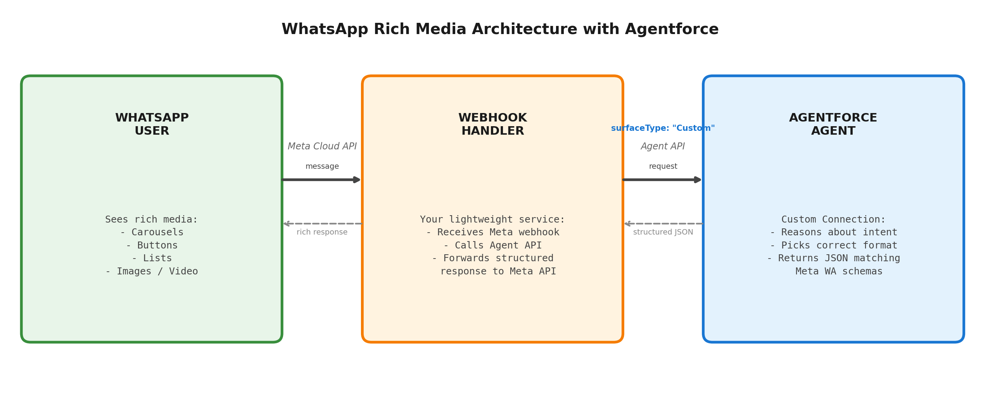

# WhatsApp Rich Media with Agentforce

Solution Guide — Custom Connections for WhatsApp

---

## Introduction

Agentforce agents can respond with rich media on WhatsApp — carousels, quick reply buttons, image/video cards, and list pickers. This guide explains how to set it up using **Custom Connections**, a feature that lets you define structured response formats your agent can use on any channel you control.

Instead of plain text, your agent outputs structured JSON that matches Meta's WhatsApp interactive message schemas. A lightweight webhook handler bridges the two APIs. The result: your customers see native WhatsApp rich media (scrollable cards, tappable buttons, expandable lists) powered by Agentforce's reasoning engine and CRM data.

The [Custom Connections skill](https://github.com/agent-connections-tools/custom-connections-skill) automates the entire Agentforce-side setup — response formats, connection definition, and deploy script — in about 15 minutes.

---

## Getting Started (End-to-End)

Follow these steps in order. No prior Custom Connections experience required.

### What you need before you start

- A Salesforce org with an Agentforce agent already created (at least one topic configured)
- The Salesforce CLI (`sf`) installed on your machine
- A Claude Code environment with the [custom-connections-skill](https://github.com/agent-connections-tools/custom-connections-skill) repo cloned
- A Meta Business account with WhatsApp Cloud API access (you'll need a test phone number)
- A publicly accessible server to host the webhook handler (Heroku, Railway, AWS, or similar)

### Step 1: Generate the Custom Connection metadata

1. Open Claude Code in the cloned repo
2. Run `/project:build-custom-connection`
3. When prompted for channel, pick **"WhatsApp rich media"**
4. Answer the remaining questions (client name, org URL, agent ID)
5. When asked about the webhook handler, say **yes** to generate it

The skill generates all response format files, the AiSurface definition, and optionally the webhook handler code in an `unpackaged/` folder.

### Step 2: Deploy metadata to your org

```bash
sf project deploy start --source-dir unpackaged/ --target-org your-org-alias
```

This deploys the 4 WhatsApp response formats and the AiSurface (Custom Connection definition) to your org.

### Step 3: Wire the Custom Connection to your agent

1. Go to **Setup > Agents** in your org
2. Open your agent
3. Add the Custom Connection you just deployed (it will appear by name)
4. Save

Your agent now knows it can respond with carousels, quick replies, lists, and media cards on WhatsApp.

### Step 4: Create the External Client App (ECA)

This gives the webhook handler server-to-server access to the Agent API.

1. Go to **Setup > External Client Apps > New External Client App**
2. Name it (e.g., "WhatsApp Webhook Bridge"), set Distribution State to "Local"
3. Enable OAuth with scopes: `api`, `chatbot_api`, `sfap_api`
4. Check "Allow client_credentials flow"
5. Set "Run as" to a dedicated Integration User (not your personal account)
6. Generate the consumer key and secret — save both securely

Do NOT add `refresh_token` to the scopes. It breaks client_credentials.

### Step 5: Set up the webhook handler

1. Deploy the generated webhook handler code to your hosting platform
2. Set environment variables:
   ```
   SF_CONSUMER_KEY=<ECA consumer key>
   SF_CONSUMER_SECRET=<ECA consumer secret>
   SF_DOMAIN=https://yourorg.my.salesforce.com
   SF_AGENT_ID=<your agent ID>
   META_VERIFY_TOKEN=<a random string you choose>
   META_WHATSAPP_TOKEN=<from Meta Cloud API dashboard>
   ```
3. Note your webhook's public URL (e.g., `https://your-app.railway.app/webhook`)

### Step 6: Configure Meta's webhook

1. Go to [developers.facebook.com](https://developers.facebook.com) > your app > WhatsApp > Configuration
2. Set the **Callback URL** to your webhook's public URL (e.g., `https://your-app.railway.app/webhook`)
3. Set the **Verify token** to the same value you used for `META_VERIFY_TOKEN`
4. Click "Verify and Save" — Meta will send a GET request to your webhook; it must respond correctly
5. Subscribe to the `messages` webhook field

### Step 7: Test it end-to-end

1. Open WhatsApp on your phone
2. Send a message to your test number — for example:
   - "Show me your products" (should return a carousel)
   - "What are my options?" (should return quick reply buttons)
   - "Which store is closest?" (should return a list message)
3. Verify the response renders as native WhatsApp rich media, not plain text
4. Tap a button or select a list item to confirm interactions work

If you see plain text instead of a format, check that the AiSurface is wired to the agent (Step 3) and that the webhook is passing `surfaceType: "Custom"` in the session config.

---

## Architecture



---

## Why a Webhook Handler Is Required

You cannot point Meta's WhatsApp webhook directly at the Agent API. Four incompatibilities require a translation layer:

| Gap | What Meta Does | What Agent API Needs |
|-----|----------------|---------------------|
| **Verification** | Sends GET challenge on registration | Has no GET handler — cannot pass verification |
| **Payload format** | Deeply nested: `entry[].changes[].value.messages[].text.body` | Flat: `{ message: { sequenceId, type, text } }` |
| **Session state** | Stateless — fires a POST per message, no session concept | Stateful — requires a pre-created session ID in the URL path |
| **Reply delivery** | Expects you to POST replies to `graph.facebook.com` | Returns response in HTTP body only — never pushes outbound |

The ECA (External Client App) is only an OAuth credential — it authenticates your service to the Agent API. It does not receive webhooks or transform payloads.

---

## Authentication: Configuring an External Client App (ECA)

The webhook is server-to-server code. It needs OAuth 2.0 `client_credentials` to call the Agent API headlessly. That's what an External Client App (ECA) is for — it replaces the older Connected App pattern with a cleaner separation of policies and consumer identity.

Configure one ECA in the org that hosts the agent before deploying the webhook.

### Step 1: Create the External Client App

Setup > External Client Apps > New External Client App

| Field | Value | Notes |
|-------|-------|-------|
| Name | WhatsApp Webhook Bridge | Or your preferred name |
| Distribution State | Local | Single-org install |
| API name | WhatsApp_Webhook_Bridge | Auto-derived from name |
| Contact email | A monitored team alias | Salesforce contacts this address about deprecations |

### Step 2: Configure the OAuth policy

| Field | Value | Why |
|-------|-------|-----|
| Enable OAuth | Yes | Required |
| Callback URL | `https://login.salesforce.com/services/oauth2/success` | Required field; not used in client_credentials but must be present |
| OAuth Scopes | `api`, `chatbot_api`, `sfap_api` | api for general access; chatbot_api for Agent API; sfap_api to invoke the agent |
| Allow client_credentials flow | Yes | Critical. Without it, the webhook can't get a token without a user. |
| Run as | Dedicated Integration User (e.g., `whatsapp_bridge_int@yourorg.com`) | Don't use a real user. Use an Integration User license. |
| Generate consumer key/secret | Yes | Store in a secrets manager — never commit to source. |

**Do NOT include `refresh_token` in the scopes.** It's incompatible with the client_credentials flow and will cause token requests to fail with `invalid_grant`.

### Step 3: Configure org-level policies

| Setting | Value |
|---------|-------|
| Permitted Users | Admin approved users are pre-authorized |
| IP Relaxation | Relax IP restrictions (server-to-server, no user session) |
| Refresh Token Policy | Refresh tokens valid until revoked (won't matter — client_credentials doesn't issue refresh tokens) |
| Permission set assigned to integration user | Custom permset granting only Agent invocation perms + agent metadata access. No Modify All Data. |

### Step 4: Wire the webhook

In the webhook handler's environment (env vars or secrets manager):

```
SF_CONSUMER_KEY=<from ECA>
SF_CONSUMER_SECRET=<from ECA>
SF_DOMAIN=https://yourorg.my.salesforce.com
SF_AGENT_ID=<your Agentforce Agent ID, the 0Xx... ID>
META_VERIFY_TOKEN=<random secret you set in Meta's webhook config>
META_WHATSAPP_TOKEN=<from Meta Cloud API>
```

The webhook fetches a token via:

```
POST https://yourorg.my.salesforce.com/services/oauth2/token
Content-Type: application/x-www-form-urlencoded

grant_type=client_credentials
&client_id=<SF_CONSUMER_KEY>
&client_secret=<SF_CONSUMER_SECRET>
```

The response includes an `access_token` with ~2 hour lifetime. The webhook should:
- Cache the token in memory until ~5 minutes before expiry
- On any 401 from the Agent API, re-fetch and retry once
- Never write the token to disk or logs

Then start an Agent session with `surfaceType: "Custom"` to activate WhatsApp response formats:

```json
POST /einstein/ai-agent/v1/agents/<SF_AGENT_ID>/sessions
Authorization: Bearer <access_token>

{
  "externalSessionKey": "<WhatsApp phone number / wa_id>",
  "instanceConfig": { "endpoint": "https://yourorg.my.salesforce.com" },
  "tz": "America/Los_Angeles",
  "variables": [],
  "surfaceConfig": { "surfaceType": "Custom" },
  "streamingCapabilities": { "chunkTypes": ["Text"] },
  "bypassUser": true
}
```

The `surfaceType: "Custom"` is what activates the WhatsApp response formats from the Custom Connection.

**Note:** `bypassUser: true` means the agent runs without a linked Salesforce Contact. This is fine for anonymous interactions. If you need personalized responses (order history, account details), set `bypassUser: false` and map the WhatsApp phone number to a Contact record in your org.

---

## How It Works (Step by Step)

1. **Customer sends a WhatsApp message** — Meta's Cloud API receives it
2. **Your webhook handler receives the event** — Lightweight service you host
3. **Webhook calls Agent API with surfaceType: "Custom"** — Activates WhatsApp response formats
4. **Agentforce agent reasons about intent** — Picks the right format for the response
5. **Agent returns structured JSON** — Already matches Meta's interactive message schema
6. **Webhook forwards JSON to Meta's Send Message API** — Customer sees rich cards in WhatsApp

---

## Responsibilities

| Layer | Owner | What It Does |
|-------|-------|-------------|
| AI Reasoning Engine | Salesforce (Agentforce) | Decides WHEN to use each format based on conversation context |
| CRM Data Access | Salesforce (Agentforce) | Customer history, lead info, preferences, service records |
| Trust Layer | Salesforce (Agentforce) | PII masking, hallucination detection, audit trail |
| Business Logic | Salesforce (Agentforce) | Lead assignment, case routing, approval processes |
| WhatsApp Response Formats | Pre-built (our tooling) | Schemas matching Meta's API with character limits enforced |
| Webhook Handler | Customer (~200 lines) | Routes messages between Meta API and Agent API |

---

## Supported WhatsApp Formats

| Format | WhatsApp Rendering | Best For | Limits |
|--------|-------------------|----------|--------|
| Quick Reply | 1-3 tappable buttons below message | Yes/No, Confirm/Cancel, simple choices | Max 3 buttons, 20 chars each |
| List Message | Expandable list picker with sections | 4-10 options grouped by category | Max 10 rows, 24 char titles |
| Media Card | Image or video with caption text | Product photos, how-to videos | Image: 5MB, Video: 16MB |
| Carousel | Horizontal scrollable cards | Product comparisons, catalogs | 2-10 cards, each with image + 2 buttons |

### How the Agent Picks the Right Format

The agent automatically selects the format based on context:

| Customer Says | Agent Uses | Why |
|---------------|-----------|-----|
| "Show me your product options" | Carousel | Multiple products to compare visually |
| "What's my order status?" | Quick Reply | 2-3 clear next actions (Confirm / Reschedule / Cancel) |
| "Which store is nearest?" | List Message | Multiple options grouped by city |
| "Show me the product details" | Media Card | Single image with descriptive caption |

---

## Frequently Asked Questions

### Does Agentforce support multimodal interactions on WhatsApp?

**Yes**, via Custom Connections. The agent outputs structured JSON matching Meta's interactive message schemas. All four rich format types (carousel, buttons, list, media) are supported today on GA Agentforce.

### What about outbound template messages?

Template messages (proactive outbound) and agent conversations (reactive inbound) are separate flows that work together:

| Direction | Mechanism | Example |
|-----------|-----------|---------|
| Outbound (you > customer) | Flow triggers WhatsApp template via Messaging Components | "Your appointment is tomorrow" with Confirm/Reschedule buttons |
| Inbound (customer > you) | Agent responds via Custom Connection with rich formats | Customer asks about products > agent shows carousel |

### Is this on the roadmap or available today?

**Available today.** No roadmap dependency. Uses:
- Agent API (GA)
- Custom Connections / AiSurface / AiResponseFormat (GA)
- Meta WhatsApp Cloud API (Meta's product, fully available)

---

## What We Have Ready Today

We have a **Custom Connections skill** that generates the entire Agentforce-side configuration:

| Generated | Purpose |
|-----------|---------|
| 4 WhatsApp response formats | Pre-built schemas matching Meta's API with character limits enforced |
| Custom Connection definition | Tells the agent "this channel supports these rich formats" |
| Surface instructions | Tells the agent WHEN to pick each format (buttons vs list vs carousel) |
| Automated deploy script | One command deploys everything and wires it to the agent |
| Optional: MIAW handoff | Agent hands off to human with full context when it can't resolve |

**Time to configure:** ~15 minutes from zero to deployed.

**Try it:** [github.com/agent-connections-tools/custom-connections-skill](https://github.com/agent-connections-tools/custom-connections-skill) — clone, run `/project:build-custom-connection`, answer 5 questions, get a deploy-ready package.

---

## Sample: What the Agent Returns

When a customer asks *"What products do you have?"*, the agent returns:

```
Body: "Here are our most popular options:"

Card 1:
  Image: product-a.jpg
  Text: "Product A — Starting $29/month"
  Buttons: [Get Started] [View Details]

Card 2:
  Image: product-b.jpg
  Text: "Product B — Starting $49/month"
  Buttons: [Get Started] [View Details]

Card 3:
  Image: product-c.jpg
  Text: "Product C — Starting $99/month"
  Buttons: [Get Started] [View Details]
```

The webhook forwards this structured JSON directly to Meta's Send Message API. The customer sees scrollable product cards in WhatsApp.

---

## Security Checklist

Before going to production, verify each of these:

| Check | Why it matters |
|-------|---------------|
| Run-as is a dedicated Integration User, not a real human user | A real user logs out, changes role, or leaves — breaking the webhook. |
| Permission set grants only Agent invocation + agent metadata access (no Modify All Data) | Limits blast radius if the consumer secret is ever leaked. |
| `chatbot_api` and `sfap_api` scopes are present; `refresh_token` is NOT in the scope list | Without these, the Agent API rejects the token (or token request itself fails). |
| Consumer key + secret stored in a managed secrets store (AWS Secrets Manager, Azure Key Vault, etc.) | Hardcoded secrets in env files end up in Git history. |
| Webhook caches the access token and refreshes ~5 min before expiry | Re-fetching on every event hits the token endpoint thousands of times per day; Salesforce rate-limits this. |
| Webhook never logs the access token or consumer secret | Token in logs = token leaked to whoever has log read access. |
| Meta's webhook signature (`X-Hub-Signature-256`) is verified on every inbound event | Without verification, an attacker can forge WhatsApp events. |
| Webhook validates the Meta `verify_token` on the GET handshake | Otherwise any third party can claim your webhook URL and intercept events. |
| ECA "Permitted Users" set to "Admin approved users are pre-authorized" | Otherwise any user in the org could self-authorize against the ECA. |
| One ECA per environment (dev / staging / prod) | Sharing credentials across environments means a dev leak compromises prod. |

---

## Common Configuration Mistakes

| Mistake | Symptom | Fix |
|---------|---------|-----|
| `refresh_token` scope included on the ECA | Token request fails with `invalid_grant` | Remove `refresh_token` from the scope list. client_credentials doesn't use refresh tokens. |
| Forgot to enable client_credentials flow | Token request returns `unsupported_grant_type` | Edit ECA's OAuth Settings > check "Allow client_credentials flow". |
| Used a regular user as "Run as" | Works in dev but fails when that user logs out | Provision a dedicated Integration User with a service-account email. |
| `chatbot_api` scope missing | Token issues fine, but Agent API returns `INSUFFICIENT_ACCESS` | Add `chatbot_api` scope. Old tokens stay invalid until they expire (~2h). |
| Webhook re-fetches token on every event | High token-endpoint volume, eventually rate-limited | Cache the token; refresh ~5 min before expiry. |
| Storing consumer secret in source / env files in Git | Eventually gets committed to a public repo | Use the cloud provider's secrets manager from day one. |

---

## Recommended Next Steps

**POC Scope:** Pick one customer engagement journey (e.g., "product inquiry" or "lead qualification"). Configure agent topic + WhatsApp Custom Connection + webhook handler pointing at a sandbox.

**Timeline:** 2-3 days for agent + connection config. 1-2 days for webhook handler. 1 week total for a working demo.

**Try the skill:** Clone [the repo](https://github.com/agent-connections-tools/custom-connections-skill), drop it into Claude Code, and run `/project:build-custom-connection`. It generates all four WhatsApp response formats, the AiSurface definition, and a one-command deploy script. This drops the Agentforce-side configuration from hours of manual work down to ~15 minutes.

**What we provide:**
- Custom Connections skill — generates all Agentforce-side metadata
- Reference architecture for the webhook handler (this guide + ECA configuration)
- WhatsApp response format library — pre-built schemas matching Meta's API with character limits enforced
