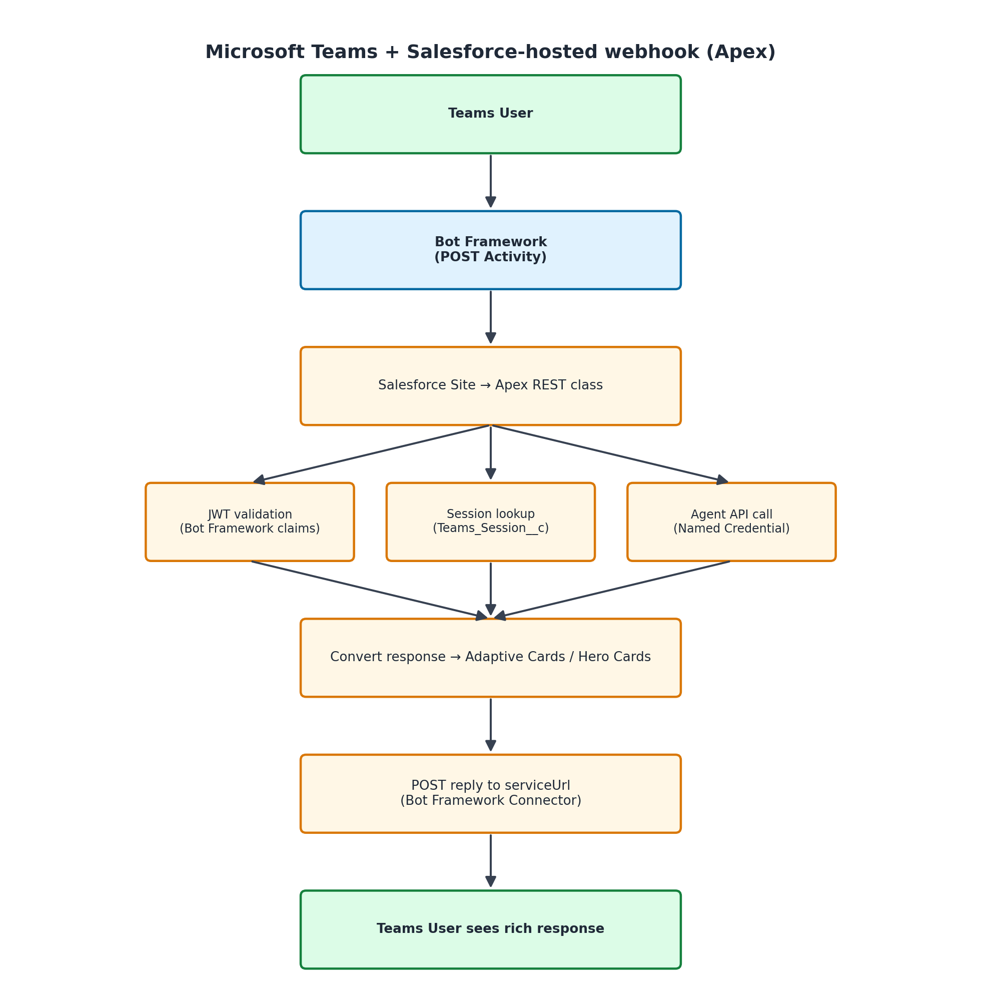

# Microsoft Teams Webhook for {ClientName} (Apex — runs inside Salesforce)

This webhook handler connects Microsoft Teams to your Agentforce agent via the Bot Framework. When someone messages your bot in Teams, this code receives it, sends it to your agent, and replies with the agent's response — including rich messages like Adaptive Cards, buttons, and carousels.

---

## Prerequisites

Before you start, make sure you have:

- [ ] An **Azure account** (portal.azure.com)
- [ ] A Salesforce org with **Agentforce** enabled and API access
- [ ] An agent (BotDefinition) already configured with a Custom Connection surface
- [ ] **Salesforce CLI** installed on your computer ([install here](https://developer.salesforce.com/tools/salesforcecli))

---

## Step 1: Create an Azure Bot Resource

1. Go to [portal.azure.com](https://portal.azure.com)
2. Click **Create a resource** and search for **Azure Bot**
3. Click **Create** and fill in:
   - **Bot handle:** A unique name (e.g., "{ClientName}-agentforce-bot")
   - **Subscription:** Your Azure subscription
   - **Resource group:** Create new or use existing
   - **Pricing tier:** F0 (free) for testing, S1 for production
   - **Type of App:** Multi Tenant
4. Click **Review + Create**, then **Create**
5. Wait for the deployment to finish

---

## Step 2: Get Microsoft App ID and Password

1. Once your Azure Bot is created, go to the resource
2. Click **Configuration** in the left menu
3. Copy the **Microsoft App ID** — you'll need it in Step 3
4. Click **Manage Password** (next to the App ID)
5. This takes you to **Certificates & secrets** in Azure AD
6. Click **New client secret**
7. Give it a description (e.g., "Salesforce webhook") and set expiration
8. Click **Add**
9. **Copy the secret value immediately** — you can't see it again after leaving this page

> **Important:** Store the App Password securely. You'll enter it in Salesforce Custom Metadata (encrypted at rest), never in source code.

---

## Step 3: Deploy to Salesforce

Open your terminal and run:

```bash
chmod +x deploy_webhook.sh
./deploy_webhook.sh
```

Or target a specific org:

```bash
./deploy_webhook.sh my-sandbox
```

This deploys:
- The Apex webhook handler class (`TeamsWebhook_{ClientName}`)
- The `Teams_Session__c` custom object (stores conversation sessions)
- Remote Site Settings for Microsoft endpoints

---

## Step 4: Create Custom Metadata Configuration

1. In Salesforce Setup, search for **Custom Metadata Types**
2. Create a new type: `Teams_Config_{ClientName}__mdt`
3. Add these fields:
   - `Microsoft_App_Id__c` (Text, 255) — the App ID from Step 2
   - `Microsoft_App_Password__c` (Text, 255) — the client secret from Step 2
   - `Agent_Id__c` (Text, 255) — your agent's BotDefinition record ID
4. Create a record named **Default** and fill in the values

---

## Step 5: Set Up Named Credentials

You need one Named Credential for the Agent API. (Microsoft token auth is handled directly via Custom Metadata in the Apex class.)

### Named Credential: Agentforce Agent API

1. In Salesforce Setup, search for **Named Credentials**
2. Click **New Named Credential**
3. Fill in:
   - **Label:** `Agentforce Agent API`
   - **Name:** `Agentforce_Agent_API`
   - **URL:** Your org's My Domain URL (e.g., `https://yourorg.my.salesforce.com`)
   - **Identity Type:** Named Principal
   - **Authentication Protocol:** OAuth 2.0
   - **Authentication Provider:** Create one for your Connected App (Client Credentials flow)
   - **Scope:** `api`

---

## Step 6: Expose the Endpoint via Salesforce Site

Your Apex REST class needs to be reachable from the internet so the Bot Framework can POST activities to it.

### Option A: Salesforce Site (simpler)

1. In Setup, search for **Sites**
2. Click **New** to create a site
3. Set the site label (e.g., "Teams Webhook")
4. Activate the site
5. Note the site URL (e.g., `https://yourorg.my.salesforce-sites.com`)
6. Go to **Site** > **Public Access Settings** > **Apex Class Access**
7. Add `TeamsWebhook_{ClientName}` to the allowed classes

Your webhook URL will be:
```
https://yourorg.my.salesforce-sites.com/services/apexrest/teams
```

### Option B: Digital Experience Site

1. In Setup, search for **Digital Experiences** > **All Sites**
2. Create a new site or use an existing one
3. Go to the site's **Administration** > **Public Access**
4. Grant access to the Apex class
5. Your URL will include the community path

---

## Step 7: Set Messaging Endpoint in Azure Bot Config

1. Go back to your Azure Bot resource in [portal.azure.com](https://portal.azure.com)
2. Click **Configuration** in the left menu
3. In the **Messaging endpoint** field, enter your Salesforce Site URL:
   ```
   https://yourorg.my.salesforce-sites.com/services/apexrest/teams
   ```
4. Click **Apply**

---

## Step 8: Install the Bot in Teams

1. In your Azure Bot resource, click **Channels** in the left menu
2. Click **Microsoft Teams** to add the Teams channel
3. Accept the Terms of Service
4. Click **Apply**

### For testing (sideload the bot):

1. Go to [Developer Portal for Teams](https://dev.teams.microsoft.com/apps)
2. Click **New app** and fill in the basic info
3. Under **App features**, click **Bot**
4. Select **Enter a bot ID manually** and paste your Microsoft App ID
5. Check the scopes you want (Personal, Team, Group Chat)
6. Click **Save**
7. Go to **Publish** > **Download app package**
8. In Teams, click the **Apps** icon > **Manage your apps** > **Upload an app**
9. Upload the .zip file you downloaded

### For production (publish to your org):

1. In the Developer Portal, go to **Publish** > **Publish to your org**
2. An admin can then approve it in the Teams Admin Center

---

## Step 9: Test

1. Open Teams and find your bot (search by name or look in recent chats)
2. Send a message like "Hello"
3. Wait a few seconds — you should get a response from your agent
4. If the agent is configured with rich response formats, you'll see Adaptive Cards

### Quick test checklist:
- [ ] Sent "Hello" — got a response
- [ ] Received an Adaptive Card with buttons — tapped one, agent understood
- [ ] Waited 30+ minutes and sent again — new session started cleanly
- [ ] Tested in a group chat (if applicable)

---

## Troubleshooting

| Problem | Likely Cause | Fix |
|---------|-------------|-----|
| Bot shows "Unable to reach app" in Teams | Messaging endpoint wrong or unreachable | Verify your Salesforce Site URL is correct in Azure Bot config. Test it with a curl POST. |
| 401 Unauthorized in debug logs | Token validation failing | Check that your Microsoft App ID in Custom Metadata matches the one in Azure. |
| Messages sent but no response comes back | Apex class not accessible via Site | Check Site > Public Access Settings > Apex Class Access |
| Response: "I'm having trouble right now" | Agent API call failing | Check Named Credential auth. Look at debug logs (Setup > Debug Logs) |
| "Read timed out" errors in logs | Agent taking too long | Check if the agent is working in the Agentforce console first |
| Session errors | Stale session data | Delete records from Teams_Session__c and try again |
| "Failed to get Bot Framework token" | App Password expired or wrong | Regenerate the client secret in Azure AD and update Custom Metadata |
| Only text replies, no Adaptive Cards | Response format not configured | Make sure your agent's Custom Connection has Teams response formats defined |
| Bot works in 1:1 but not in group chat | Bot not @mentioned | In group chats, users must @mention the bot. The handler strips the @mention tag automatically. |

---

## How It Works (Architecture)



---

## Security Notes

- Microsoft App Password is stored in Custom Metadata (encrypted at rest), never in code
- Inbound requests are validated by checking JWT claims (issuer, audience, expiration)
- For full cryptographic JWT signature validation, consider adding an Azure Function as middleware (Salesforce Apex lacks native RSA/JWKS verification)
- All external calls use either Named Credentials or Custom Metadata-stored secrets
- The Apex class uses `with sharing` to respect org security model
- User names and IDs are stored for audit purposes only — no passwords or tokens in session records
- Remote Site Settings restrict which external URLs the code can call
