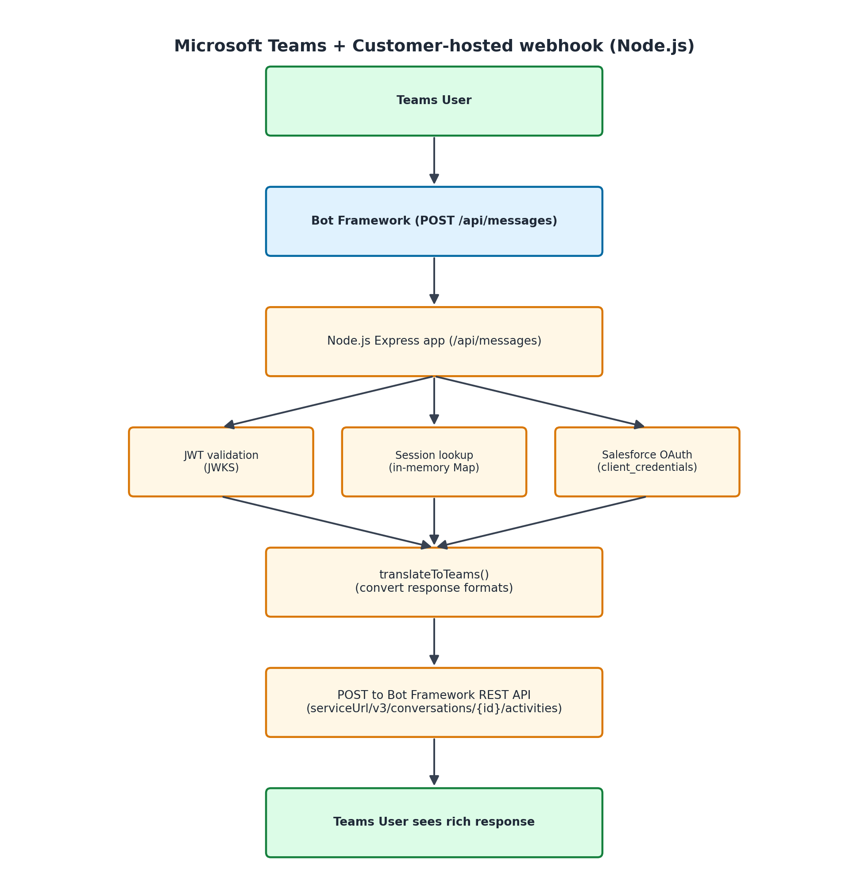

# Microsoft Teams Webhook for {ClientName} (Node.js — deploy anywhere)

This webhook handler connects Microsoft Teams to your Agentforce agent via Bot Framework. When someone messages your bot in Teams, this app receives it, sends it to your agent, and replies with the agent's response — including rich messages like Adaptive Cards, Hero Cards, and carousels.

Runs on: Heroku, Railway, Azure App Service, or any platform that hosts Node.js apps.

---

## Prerequisites

Before you start, make sure you have:

- [ ] **Node.js 18+** installed on your computer ([download here](https://nodejs.org))
- [ ] A **Heroku** or **Railway** account for hosting
- [ ] An **Azure account** ([portal.azure.com](https://portal.azure.com))
- [ ] A Salesforce org with **Agentforce** enabled
- [ ] An agent already configured with a Custom Connection surface
- [ ] An External Client App (ECA) set up in Salesforce (Client Credentials flow)

---

## Step 1: Create an Azure Bot Resource

1. Go to [portal.azure.com](https://portal.azure.com) and sign in
2. Click **Create a resource** and search for "Azure Bot"
3. Click **Create** and fill in:
   - **Bot handle:** A unique name (e.g., `{ClientName}-agentforce-bot`)
   - **Subscription:** Your Azure subscription
   - **Resource group:** Create new or use existing
   - **Pricing tier:** F0 (free) is fine for testing
   - **Type of App:** Single Tenant or Multi Tenant
   - **Creation type:** Create new Microsoft App ID
4. Click **Review + Create**, then **Create**
5. Wait for deployment to complete, then click **Go to resource**

---

## Step 2: Get Microsoft App ID and Password

1. In your Azure Bot resource, go to **Configuration**
2. Copy the **Microsoft App ID** (you'll need this in Step 3)
3. Click **Manage Password** next to the App ID
4. This opens the App Registration in Azure AD
5. Go to **Certificates & secrets** > **New client secret**
6. Add a description (e.g., "Teams bot secret"), set expiry, and click **Add**
7. Copy the **Value** immediately (it won't be shown again) — this is your `MICROSOFT_APP_PASSWORD`

---

## Step 3: Deploy the Handler

### Option A: Deploy to Heroku (one command)

1. Copy `.env.example` to `.env` and fill in your values:
   ```bash
   cp .env.example .env
   ```

2. Open `.env` in any text editor and fill in all the values from Steps 1 and 2

3. Run the deploy script:
   ```bash
   chmod +x deploy_heroku.sh
   ./deploy_heroku.sh
   ```

4. The script will print your messaging endpoint when done

### Option B: Deploy to Railway

1. Install Railway CLI: `npm install -g @railway/cli`
2. Login: `railway login`
3. Create project: `railway init`
4. Set each environment variable:
   ```bash
   railway variables set MICROSOFT_APP_ID=your-app-id
   railway variables set MICROSOFT_APP_PASSWORD=your-app-password
   railway variables set SF_LOGIN_URL=https://login.salesforce.com
   railway variables set SF_CLIENT_ID=your-consumer-key
   railway variables set SF_CLIENT_SECRET=your-consumer-secret
   railway variables set SF_AGENT_ID=your-agent-id
   ```
5. Deploy: `railway up`
6. Get your URL: `railway domain`

### Option C: Run locally (for testing)

```bash
npm install
cp .env.example .env
# Fill in .env values
npm start
```

Use [ngrok](https://ngrok.com) to expose your local server:
```bash
ngrok http 3978
```

---

## Step 4: Set the Messaging Endpoint in Azure Bot

1. Go back to your Azure Bot resource at [portal.azure.com](https://portal.azure.com)
2. Click **Configuration** in the left menu
3. Set **Messaging endpoint** to your deployed URL + `/api/messages`:
   - Heroku: `https://teams-webhook-{ClientName}.herokuapp.com/api/messages`
   - Railway: `https://your-app.up.railway.app/api/messages`
   - ngrok (local): `https://abc123.ngrok.io/api/messages`
4. Click **Apply** / **Save**

---

## Step 5: Install the Bot in Teams

### Option A: Via Teams Developer Portal (recommended for testing)

1. Go to [dev.teams.microsoft.com](https://dev.teams.microsoft.com)
2. Click **Apps** > **New app**
3. Fill in basic info (name, description, etc.)
4. Under **App features** > **Bot**, click **Add**
5. Select **Enter a bot ID manually** and paste your **Microsoft App ID**
6. Check the scopes you want: Personal, Team, Group Chat
7. Click **Save**
8. Click **Preview in Teams** to test immediately

### Option B: Via Teams Admin Center (for org-wide deployment)

1. Go to [admin.teams.microsoft.com](https://admin.teams.microsoft.com)
2. Navigate to **Teams apps** > **Manage apps**
3. Click **Upload new app** and upload your app manifest (ZIP)
4. Approve the app for your organization
5. Users can then find the bot in Teams' app store

### Option C: Via app manifest ZIP

1. Create a `manifest.json` with your bot's App ID and details
2. Include two icon files (color: 192x192, outline: 32x32)
3. ZIP the three files together
4. In Teams, click **Apps** > **Upload a custom app** > select your ZIP

---

## Step 6: Test End-to-End

1. Open Microsoft Teams
2. Find your bot in Apps or start a chat with it directly
3. Send a message (e.g., "Hello")
4. Wait a few seconds — you should see a response from your agent
5. If your agent uses rich response formats, you'll see:
   - **Adaptive Cards** — interactive cards with buttons or dropdowns
   - **Hero Cards** — cards with images, titles, and action buttons
   - **Carousels** — horizontally scrollable sets of cards

### Quick test checklist:
- [ ] Sent "Hello" — got a response
- [ ] Clicked a button — agent understood the selection
- [ ] Sent a question that triggers a choice set — dropdown appeared
- [ ] Waited 30+ minutes and sent again — new session started cleanly

---

## Troubleshooting

| Problem | Likely Cause | Fix |
|---------|-------------|-----|
| Bot doesn't respond at all | Messaging endpoint not set or wrong | Check Azure Bot > Configuration > Messaging endpoint matches your deployed URL |
| 401 Unauthorized in logs | App ID/Password mismatch | Verify MICROSOFT_APP_ID and MICROSOFT_APP_PASSWORD match Azure Bot registration |
| "I'm having trouble right now" reply | Agent API call failed | Check logs (`heroku logs --tail`). Verify agent works in Agentforce console |
| 401 from Salesforce | Token expired or bad credentials | Double-check ECA credentials. Make sure scopes include `einstein_gpt_api` |
| Bot responds in Azure test but not Teams | Bot not installed in Teams | Follow Step 5 to add the bot to Teams |
| Cards don't render properly | Adaptive Card schema version | Teams supports Adaptive Cards up to version 1.4. Check card JSON |
| "Failed to get signing key" in logs | Network issue reaching Microsoft JWKS | Check outbound HTTPS connectivity from your host |
| App crashes on start | Missing env vars | Check that all required environment variables are set |
| Sessions reset unexpectedly | App restarted (in-memory sessions lost) | Expected on free-tier Heroku. For production, add Redis (see below) |

---

## Monitoring

### View logs

**Heroku:**
```bash
heroku logs --tail --app teams-webhook-{ClientName}
```

**Railway:**
```bash
railway logs
```

### What the logs show

- `[Message] From: conv123, Text: "Hello"` — incoming message received
- `[Session] Creating new session for conv123` — new conversation started
- `[Teams API] Message sent to conv123` — reply delivered
- `[Auth] Refreshing Salesforce access token` — Salesforce token rotation (normal)
- `[Auth] Refreshing Bot Framework token` — Bot Framework token rotation (normal)
- `[Error] ...` — something went wrong (check the message)

---

## Environment Variables Reference

| Variable | Required | Description |
|----------|----------|-------------|
| `MICROSOFT_APP_ID` | Yes | Bot's App ID from Azure Bot registration |
| `MICROSOFT_APP_PASSWORD` | Yes | Bot's client secret from Azure AD app |
| `SF_LOGIN_URL` | No | Salesforce login URL (default: `https://login.salesforce.com`) |
| `SF_CLIENT_ID` | Yes | Consumer Key from your Salesforce ECA |
| `SF_CLIENT_SECRET` | Yes | Consumer Secret from your Salesforce ECA |
| `SF_AGENT_ID` | Yes | BotDefinition record ID (starts with `0Xx`) |
| `PORT` | No | Server port (default: `3978`) |

---

## Production Recommendations

For a production deployment handling real user traffic:

1. **Use Redis for sessions** — In-memory sessions are lost when the app restarts. Add Redis:
   ```bash
   heroku addons:create heroku-redis:mini
   ```
   Then swap the `sessions` Map for a Redis client.

2. **Rotate your App Password** — Azure AD client secrets expire. Set a calendar reminder to rotate before expiry.

3. **Deploy to Azure App Service** — For the lowest latency to Bot Framework, host in Azure. The same code runs there without changes.

4. **Monitor with alerts** — Set up log-based alerts for `[Error]` entries.

5. **Scale horizontally** — The app is stateless (if using Redis). Add more dynos/instances as needed.

---

## How It Works (Architecture)


