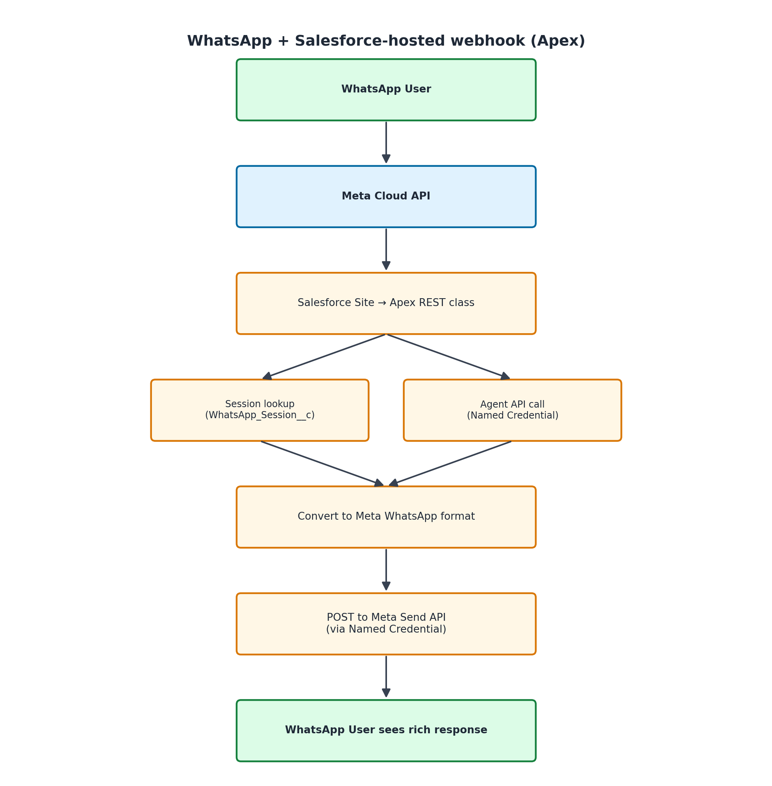

# WhatsApp Webhook for {ClientName} (Apex — runs inside Salesforce)

This webhook handler connects Meta's WhatsApp Cloud API to your Agentforce agent. When someone sends a WhatsApp message to your business number, this code receives it, sends it to your agent, and replies with the agent's response — including rich messages like buttons, lists, and images.

---

## Prerequisites

Before you start, make sure you have:

- [ ] A **Meta Business Account** (business.facebook.com)
- [ ] **WhatsApp Business API** access (applied through Meta Business Suite)
- [ ] A phone number registered with WhatsApp Business
- [ ] A Salesforce org with **Agentforce** enabled
- [ ] An agent (BotDefinition) already configured with a Custom Connection surface
- [ ] **Salesforce CLI** installed on your computer ([install here](https://developer.salesforce.com/tools/salesforcecli))

---

## Step 1: Create a Meta App

1. Go to [developers.facebook.com](https://developers.facebook.com) and click **Create App**
2. Select **Business** as the app type
3. Fill in a name (e.g., "{ClientName} WhatsApp Bot") and select your Business Account
4. Once created, find **WhatsApp** in the product list and click **Set Up**
5. You'll see a **Temporary Access Token** — copy it (you'll need it in Step 3)
6. Note your **Phone Number ID** — it's displayed on the WhatsApp > Getting Started page

> **Important:** The temporary token expires in 24 hours. For production, create a permanent System User token in Meta Business Suite > Settings > Business Settings > System Users.

---

## Step 2: Deploy the Code to Salesforce

Open your terminal and run:

```bash
chmod +x deploy_webhook.sh
./deploy_webhook.sh
```

This deploys:
- The Apex webhook handler class
- The `WhatsApp_Session__c` custom object (stores conversation sessions)

---

## Step 3: Set Up Named Credentials

You need two Named Credentials — one for calling Meta's API, one for the Agent API.

### Named Credential: Meta WhatsApp API

1. In Salesforce Setup, search for **Named Credentials**
2. Click **New Named Credential**
3. Fill in:
   - **Label:** `Meta WhatsApp API`
   - **Name:** `Meta_WhatsApp_API`
   - **URL:** `https://graph.facebook.com`
   - **Identity Type:** Named Principal
   - **Authentication Protocol:** Custom Header
   - **Header Name:** `Authorization`
   - **Header Value:** `Bearer YOUR_META_ACCESS_TOKEN`

> Replace `YOUR_META_ACCESS_TOKEN` with the token from Step 1.

### Named Credential: Agentforce Agent API

1. Click **New Named Credential** again
2. Fill in:
   - **Label:** `Agentforce Agent API`
   - **Name:** `Agentforce_Agent_API`
   - **URL:** Your org's My Domain URL (e.g., `https://yourorg.my.salesforce.com`)
   - **Identity Type:** Named Principal
   - **Authentication Protocol:** OAuth 2.0
   - **Authentication Provider:** Create one for your Connected App (Client Credentials flow)
   - **Scope:** `api`

---

## Step 4: Create Custom Metadata Configuration

1. In Setup, search for **Custom Metadata Types**
2. Create a new type: `WhatsApp_Config_{ClientName}__mdt`
3. Add these fields:
   - `Verify_Token__c` (Text, 255) — make up any random string, you'll use it in Step 6
   - `Agent_Id__c` (Text, 255) — your agent's BotDefinition record ID
   - `Phone_Number_Id__c` (Text, 50) — your Meta Phone Number ID from Step 1
4. Create a record named **Default** and fill in the values

---

## Step 5: Expose the Endpoint via Salesforce Site

Your Apex REST class needs to be reachable from the internet so Meta can send webhooks to it.

### Option A: Salesforce Site (simpler)

1. In Setup, search for **Sites**
2. Click **New** to create a site
3. Set the site label (e.g., "WhatsApp Webhook")
4. Activate the site
5. Note the site URL (e.g., `https://yourorg.my.salesforce-sites.com`)
6. Go to **Site** > **Public Access Settings** > **Apex Class Access**
7. Add `WhatsAppWebhook_{ClientName}` to the allowed classes

Your webhook URL will be:
```
https://yourorg.my.salesforce-sites.com/services/apexrest/whatsapp/{ClientName}/webhook
```

### Option B: Digital Experience Site

1. In Setup, search for **Digital Experiences** > **All Sites**
2. Create a new site or use an existing one
3. Go to the site's **Administration** > **Public Access**
4. Grant access to the Apex class
5. Your URL will include the community path

---

## Step 6: Configure the Webhook URL in Meta

1. Go back to your Meta App at [developers.facebook.com](https://developers.facebook.com)
2. Navigate to **WhatsApp** > **Configuration**
3. Under **Webhook**, click **Edit**
4. Enter:
   - **Callback URL:** Your Salesforce Site URL + `/services/apexrest/whatsapp/{ClientName}/webhook`
   - **Verify Token:** The same random string you put in Custom Metadata (Step 4)
5. Click **Verify and Save**
6. Subscribe to the **messages** field

---

## Step 7: Test

1. Send a text message from your phone to the WhatsApp Business number
2. Wait a few seconds — you should get a response from your agent
3. If the agent is configured with rich response formats, you'll see buttons, lists, or images

### Quick test checklist:
- [ ] Sent "Hello" — got a response
- [ ] Tapped a button — agent understood the selection
- [ ] Waited 30+ minutes and sent again — new session started cleanly

---

## Troubleshooting

| Problem | Likely Cause | Fix |
|---------|-------------|-----|
| Meta says "Callback URL verification failed" | Verify token mismatch | Check that the token in Meta matches exactly what's in your Custom Metadata record |
| Messages sent but no response comes back | Apex class not accessible | Check Site > Public Access Settings > Apex Class Access |
| Response: "I'm having trouble right now" | Agent API call failing | Check Named Credential auth. Look at debug logs (Setup > Debug Logs) |
| "Read timed out" errors in logs | Agent taking too long | Check if the agent is working in the Agentforce console first |
| Session errors | Stale session data | Delete records from WhatsApp_Session__c and try again |
| 403 from Meta Send API | Token expired | Generate a new permanent token via System User in Meta Business Suite |
| Only text replies, no buttons | Response format not configured | Make sure your agent's Custom Connection has WhatsApp response formats defined |

---

## How It Works (Architecture)



---

## Security Notes

- Meta access tokens are stored in Named Credentials (encrypted at rest), never in code
- The webhook verifies Meta's verification token before responding to challenges
- All external calls use Named Credentials (managed auth, rotatable)
- The Apex class uses `with sharing` to respect org security model
- Phone numbers are stored without PII context — just the number and session ID
